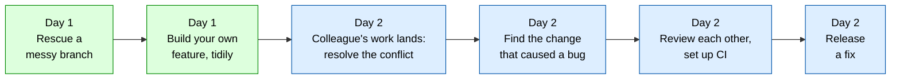

:::::::::::::::::::::::::::::::::::::: questions

- What will we do over these two half-days, and why?
- What is the project we'll be working on?

::::::::::::::::::::::::::::::::::::::::::::::::

::::::::::::::::::::::::::::::::::::: objectives

- Explain what "curating history" means
- Check your setup works
- Meet `peakfinder` and your pair partner

::::::::::::::::::::::::::::::::::::::::::::::::

<!--
No git is taught in this episode. It sets the scene, finds out who's stuck on setup, and gets pairs sorted
(including adding partners as collaborators, which saves a delay on day 2).
The two example logs use real output from tools/build_starter.py.
-->

## Welcome

This workshop is about a habit more than a command:

> **Leave a git trail that is easy to review, merge and understand.**

You already know how to *make* history. Over the next two half-days we'll learn how to *curate* it: to shape the commits you
leave behind so that the people who read them, including you in six months, can follow what happened and why.

It is not a course on obscure git commands. It's a course on how one working style, with a handful of tools, makes
collaboration much easier. Along the way we'll look *inside* git, because the tools make more sense when you know what git is doing.

## Why bother?

Two versions of the same piece of work, as a `git log`. Take a moment to read them.

**Version A**

```output
d8cc138 readme
9e1626f try smoothing
4244130 fix typo
2b17bef cli stuff
9a6471e remove print
89f7c6f add tests
33aa1de fix
21dd6b4 tidy up
ead2b48 wip
cd6792e add background module
```

**Version B**

```output
b8f52dd Document --subtract-background in the README
e7fab65 Add --subtract-background option to the CLI
514955f Add tests for background subtraction
37e6d49 Add rolling minimum background subtraction
17f1b3d Check x and y are the same length in find_peaks
754c449 Let load_spectrum skip a variable number of header rows
5fb3ed3 Handle constant spectra in normalise
```

The two contain **exactly the same code**. Only the story is different.

::::::::::::::::::::::::::::::::::::: challenge

## Discussion: which would you rather review?

Vote (a show of hands in the room, or a reaction in the chat) for the one you'd rather review. Then, with the person next to you
(or in the chat), say *why*. Think about:

- Could you tell what each commit is for?
- What if a bug turned up in one of the changes? Which log makes it easier to find, undo or copy somewhere else?
- Which one tells you *why* the code changed, not just that it did?

:::::::::::::::::::::::: solution

Nearly everyone picks B. In A, you can't tell what `wip`, `fix` or `tidy up` mean without opening each commit. Some of the
changes are unrelated to each other. And one commit, `try smoothing`, is an experiment that was abandoned.

In B, every line says what the change is, and each change is separate. You can review them one at a time, revert one, or copy a
single fix onto another branch.

By the end of tomorrow, you'll be able to turn A into B, and better, you'll learn how to write B in the first place.

:::::::::::::::::::::::::::::::::

::::::::::::::::::::::::::::::::::::::::::::::::

## The story

Throughout the workshop we'll work on a small Python package called **`peakfinder`**. It finds peaks in spectra: the bumps in a
curve that tell you something about a sample. You'll need no knowledge of spectroscopy. The code is deliberately short and plain.

Try it, now. In your `peakfinder` clone (with your virtual environment active):

```bash
python -m peakfinder.cli data/example_spectrum.csv | wc -l
python -m peakfinder.cli data/example_spectrum.csv --plot
```

```output
71
```

The program reports **71** "peaks", but there are only **three** real ones. All the other bumps are noise. (If a plot window appears, you'll
see the three big peaks and a lot of little red dots. If no window opens, use `--save-plot spectrum.png` and open the file.)

We have a job to do. We're going to improve `peakfinder`, and we want to do it in a way our collaborators can follow.



- **Day 1: you are the author.** You'll learn how git really works, how to plan changes, and how to rescue a messy branch.
  Then you'll build a feature of your own, one tidy commit at a time.
- **Day 2: you are a collaborator.** A colleague's work lands on `main` while you were busy, so you'll deal with the conflict. Then you'll
  track down the change that caused a bug, review each other's work, and release a fix.

## The plan for the two days

- **Day 1: making history.** How git really works, planning and atomic commits, a safety net, shaping commits, rewriting a messy branch, and the daily loop that keeps history tidy.
- **Day 2: sharing and maintaining history.** Rebase versus merge and conflicts, tracking down a bug, pull requests, catching problems early with CI, and releasing a fix.

The episodes are listed in the sidebar. We'd rather go at a comfortable pace than cover everything. If we run short of time, we'll skip things at the end, rather than rush.

## Work in pairs

You'll work in pairs. Your partner is the person who **reviews your pull request** on day 2, and who you can ask for help. You each work
on your own computer and your own copy of the project.

Online, we'll put you in breakout rooms of two.

**Do this now, to save time tomorrow.** Give your partner access to your fork:

1. On GitHub, open **your fork** of `peakfinder`, then **Settings**, then **Collaborators**, then **Add people**.
2. Enter your partner's GitHub username.
3. Your partner will get an email invitation, and should **accept** it. (You can also accept at
   `https://github.com/YOUR-USERNAME/peakfinder/invitations`, using your *own* username.)

Do it in both directions, so you each have access to the other's fork.

## Quick check before we start

Please check the following. Put a hand up (or message the helpers) if any of them is a problem:

- [ ] `git status` says `nothing to commit, working tree clean`, and you're on `main`
- [ ] `git branch -r` shows several `origin/` branches, and `git tag` shows `v0.1.0` and `v0.2.0`
- [ ] `pytest` passes
- [ ] `git push` works
- [ ] Your partner can see your fork

## Ground rules

- **Ask questions at any time.** If something looks odd, it probably is, and someone else is wondering too.
- **Help your partner**, but let them type. People learn from doing.
- **Nothing here is permanent.** We'll be breaking things deliberately, and git almost always lets us get back. We'll
  learn how in episode 4.
- We follow The Carpentries [Code of Conduct](https://docs.carpentries.org/policies/coc/).

::::::::::::::::::::::::::::::::::::: instructor

**Timing.** 10 minutes talking, 5 for the discussion. If the setup check turns up problems, give helpers the stragglers and keep going. Don't
let the whole room wait for one laptop.

**The hook.** Put the two logs up side by side. Don't tell people which is "right". Let them say it. Then say
*"The code is identical."* That is the idea of the whole workshop.

**Noisy plot.** Make sure everyone has seen the 71. In episode 7 they'll write a feature to fix it, and it helps them to care.

**Collaborator invitations.** This is where people get stuck: the invitation sits in an email, and the invitee must accept. Check that pairs
have done it *now*. On day 2, PR review needs it.

**Common setup problems** (see the setup page for fixes):

- forked with "Copy the main branch only" ticked (so only `main`, no tags): delete the fork and fork again
- no way to `git push` (authentication)
- `core.editor` not set, so the rebase editor will be vim
- virtual environment not active, so `pytest` is not found

**Online.** Drop the list of pairs in the chat, and create the breakout rooms before they're needed. Have a helper in every room if possible.

**Pairs with an odd number.** A trio works: one person is the reviewer for the next.

::::::::::::::::::::::::::::::::::::::::::::::::

::::::::::::::::::::::::::::::::::::: keypoints

- This workshop is about *curating* history: leaving commits that are easy to review, merge and understand
- The same code can have a confusing history or a clear one, and the clear one is far easier to work with
- Day 1 is about producing good history, and day 2 is about sharing and maintaining it
- You'll work in pairs, and your partner reviews your pull request

::::::::::::::::::::::::::::::::::::::::::::::::
