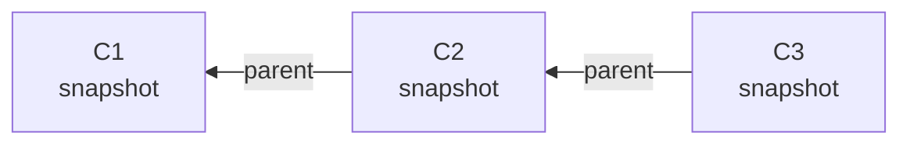
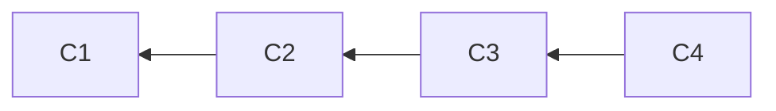
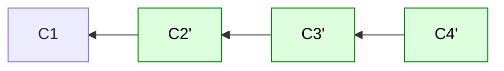
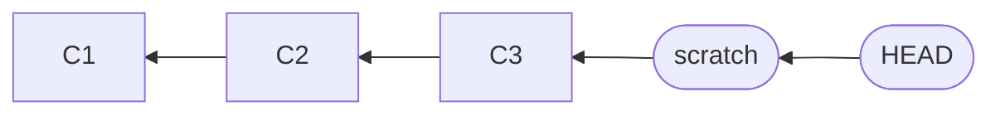
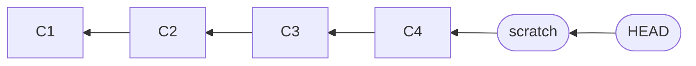
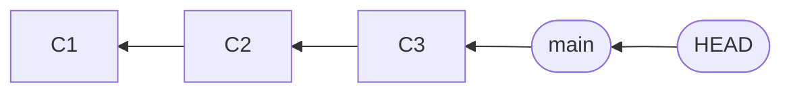
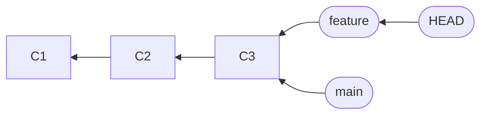
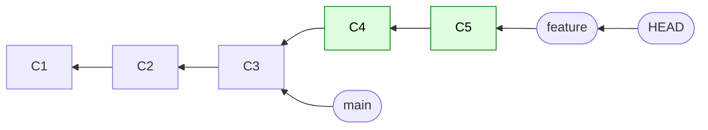
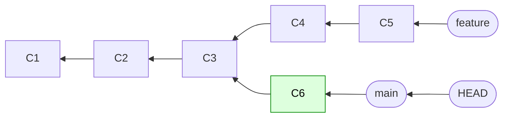

:::::::::::::::::::::::::::::::::::::: questions

- What is a commit, really?
- What are branches and `HEAD`?
- Why does "rewriting history" create new commits, rather than editing old ones?

::::::::::::::::::::::::::::::::::::::::::::::::

::::::::::::::::::::::::::::::::::::: objectives

- Describe a commit as a snapshot that points to its parent
- Explain why changing a commit changes its hash, and the hashes of everything after it
- Explain branches and `HEAD` as labels that point at commits
- Use this model to predict what a command will do

::::::::::::::::::::::::::::::::::::::::::::::::

<!--
Aim: a model that is GOOD ENOUGH for the rest of the course, not a complete one.
The model has to carry four later episodes:
  - reflog (04):   old commits don't vanish
  - rebase (06/09): rebase makes NEW commits with new hashes
  - force-push (09/11): the remote's history is different from mine
  - cherry-pick (13): a commit can be copied as a change
We skip trees, blobs, packfiles and so on. Mention "tree" once, then move on.
-->

## Why bother?

You already use git every day without knowing what is inside it, and that's fine.
But in this workshop we will be *changing history*, and it's much less scary if you know what
git is actually doing. We need just four ideas.

## Idea 1: a commit is a snapshot

You have probably heard that a commit is "a set of changes". That is a useful way to think about it,
and we will use it too. But it is not what git stores.

**Git stores a snapshot of your whole project at that moment, along with a message, an author, and a pointer to the
previous commit** (the *parent*).

Let's look inside a real one. In your `peakfinder` clone, first list the latest commits. The top one is the commit that
`HEAD` is on, which means "where you are now":

```bash
git log --oneline -3
```

Now print the **commit object** for that commit. This is the commit as git stores it:

```bash
git cat-file -p HEAD
```

```output
tree 82fa2f38d5d1864f890ecd4ef923bafbb8e65985
parent b7cf029bfa65c05266bfce11a30c889f9e36378d
author Sam Scientist <sam.scientist@example.org> 1736175600 +0000
committer Sam Scientist <sam.scientist@example.org> 1736175600 +0000

Add plotting of the spectrum and its peaks
```

That is all a commit is: a small piece of text. (`cat-file -p` prints a git object, and here the object is the commit at
`HEAD`.) Three things are worth noticing:

- `tree` is the hash of another git object (a *tree*), which stores a snapshot of every file in the project at this point
  in time. We won't go any deeper than that.
- `parent` is the hash of **another commit**: the one that came before. Look back at your `git log` output and you'll find it
  just below.
- The rest is the author, date and message.

Here is the part that matters. **A commit's hash is (essentially) a hash of this text.** You can check:

```bash
git rev-parse HEAD
git cat-file -p HEAD | git hash-object -t commit --stdin
```

```output
1e81f2713978c508941a5b8366aabd892b635104
1e81f2713978c508941a5b8366aabd892b635104
```

The same hash, twice. (`git log --oneline` only shows the first 7 characters.) Keep this in mind, as the text includes the parent's
hash, and we'll see in a moment why that matters.

So where is the "change"? It isn't there. When you run `git show` or `git diff`, git **works out** the differences between
two snapshots on the spot.



Notice that the arrows point **backwards**, from each commit to its parent. That's how git stores it: a commit knows
its parent, but it doesn't know its children. So in all the diagrams from here on, **time runs from left to right**: the oldest commit is on the left, and the arrows point back towards it.

::::::::::::::::::::::::::::::::::::: callout

## So is a commit a snapshot or a diff?

Both ideas are useful, a bit like light being a wave *and* a particle.

- When you **review**, **cherry-pick** or **write a commit message**, think of a commit as a *change* (a diff).
- When you ask "what does the project look like at this commit?", or you wonder how **rebase** works,
  think of it as a *snapshot*.

We will tell you which one we mean when it matters.

::::::::::::::::::::::::::::::::::::::::::::::::

## Idea 2: hashes chain commits together

Every commit has an ID, like `1e81f27`. It's called a *hash*, and it's calculated from the
**contents** of the commit, including the **parent's hash**.

This has an important consequence:

> If you change anything about a commit, it gets a new hash.
> And then its child has a different parent, so the child gets a new hash too,
> and so on all the way to the tip of the branch.

**Before:**



**After changing C2:**



*Green marks commits that are new. Everything after the change gets a new hash.*

There is no such thing as editing a commit in git. You can only make a *new, similar* commit.
This is exactly why rewriting history is a thing you have to do carefully.

Try it. Make a scratch branch and change the message of the latest commit:

```bash
git switch -c scratch
git log --oneline -1
git commit --amend -m "A different message"
git log --oneline -1
```

```output
1e81f27 Add plotting of the spectrum and its peaks
...
c91e7a2 A different message
```

The hash is different. (Yours will be, too, as it also depends on the time you did it.)

## Idea 3: old commits don't disappear

So what happened to `1e81f27`? Ask git for it:

```bash
git show 1e81f27 --stat
```

It's still there, and still intact. Nothing points to it from `scratch` any more, but git hasn't
deleted it. Git keeps a private diary of where `HEAD` has been, called the **reflog**, and we'll use it in episode 4 to get
back to commits like this one. It's why we can be relaxed about trying risky things in episode 6.

(The commit stays until git's *garbage collection* removes unreachable commits, which only happens after a few weeks.)

## Idea 4: branches and HEAD are labels

If commits never change, how does a branch "move" when you add a commit?

A branch is a **label** (a name) that points at one commit. It's a tiny file containing a hash:

```bash
cat .git/refs/heads/scratch
git log --oneline -1
```

When you commit, git makes the new commit and **moves the label** forward to it.

`HEAD` is also a label: it says "where you are now". Usually it points at a branch, which
points to a commit:

```bash
cat .git/HEAD
```

```output
ref: refs/heads/scratch
```



Now add a commit and the label moves:



`git switch` moves `HEAD` to a different label. `git branch name` sticks a new label on the current commit.
Making and deleting branches is cheap because a label is all they are.

::::::::::::::::::::::::::::::::::::: callout

## What is "detached HEAD"?

It's `HEAD` pointing at a commit directly, instead of at a branch. You get it if you check out an
old commit, and git warns you about it. It isn't a problem. It simply means that if you commit now, no branch label
will move to follow you. We'll use it deliberately in the `bisect` episode.

::::::::::::::::::::::::::::::::::::::::::::::::

Clean up your scratch branch:

```bash
git switch main
git branch -D scratch
```

::::::::::::::::::::::::::::::::::::: challenge

## Knowledge check: where are the labels?

You don't need to type anything for this one. Start from here:



Now these commands are run, one after the other. (`--allow-empty` just lets us make commits without changing any files.)

```bash
git switch -c feature
git commit --allow-empty -m "C4"
git commit --allow-empty -m "C5"
git switch main
git commit --allow-empty -m "C6"
```

On paper, or in your head: **where do `main`, `feature` and `HEAD` point at the end?** Which label moved at each step?

:::::::::::::::::::::::: solution

Step by step, the labels move like this. (Green marks commits that are new.)

**After `git switch -c feature`**: nothing moved except `HEAD`. A new label was stuck on C3.



**After the two commits (C4, C5)**: each commit moved the label `HEAD` was on, `feature`, forwards. `main` stayed where it was.



**After `git switch main` and the commit C6**: switching moved only `HEAD`. Then C6 moved `main`. The history has **diverged** from C3.



So at the end `feature` is at C5, and `main` and `HEAD` are at C6. We'll see two ways to bring the two lines together in episode 9.

:::::::::::::::::::::::::::::::::

::::::::::::::::::::::::::::::::::::::::::::::::

::::::::::::::::::::::::::::::::::::: challenge

## Knowledge check: new hash or not?

Which of these gives the commit a new hash?

1. Fixing a typo in its message
2. Moving the branch label to a different commit
3. Changing the commit that comes *before* it

:::::::::::::::::::::::: solution

1. **Yes**: the message is part of the commit's contents.
2. **No**: the commit isn't changed, only the label.
3. **Yes**: the parent is part of its contents, so the hash changes as well.

:::::::::::::::::::::::::::::::::

::::::::::::::::::::::::::::::::::::::::::::::::

::::::::::::::::::::::::::::::::::::: instructor

Keep this brisk (about 25 minutes). The goal is a *useful* model, not a complete one, and people
may ask about trees, blobs or packfiles. Park those and point them at the extras. If you want a deeper
treatment (optional, end of day 2, or the learner reference), the deep dive is: objects (blobs, trees, commits, tags), content
addressing, `git hash-object`, `.git/objects`.

Likely questions:

- *"So git doesn't store diffs?"* Conceptually it stores snapshots. Under the hood it is
  clever about storing them compactly (packfiles), but you don't need to care.
- *"What if two commits have the same content?"* Different parents or timestamps mean different hashes.
- *"Can I see the old commit later?"* Yes, that's the next-but-one episode (reflog).

<!-- The arrows point from child to parent, which can surprise people. The text says so explicitly under the first diagram. The diagrams are Mermaid: the source is shown under each one ("Diagram source code"), which is handy for learners who want to draw their own. -->

::::::::::::::::::::::::::::::::::::::::::::::::

::::::::::::::::::::::::::::::::::::: keypoints

- A commit is a snapshot of the project plus a pointer to its parent. Diffs are worked out when needed
- A commit's hash depends on its contents *and* its parent, so changing one commit changes all those after it
- You can't edit a commit, only make a new one. The old one is still there
- Branches and `HEAD` are just labels pointing at commits. Committing moves the label

::::::::::::::::::::::::::::::::::::::::::::::::
