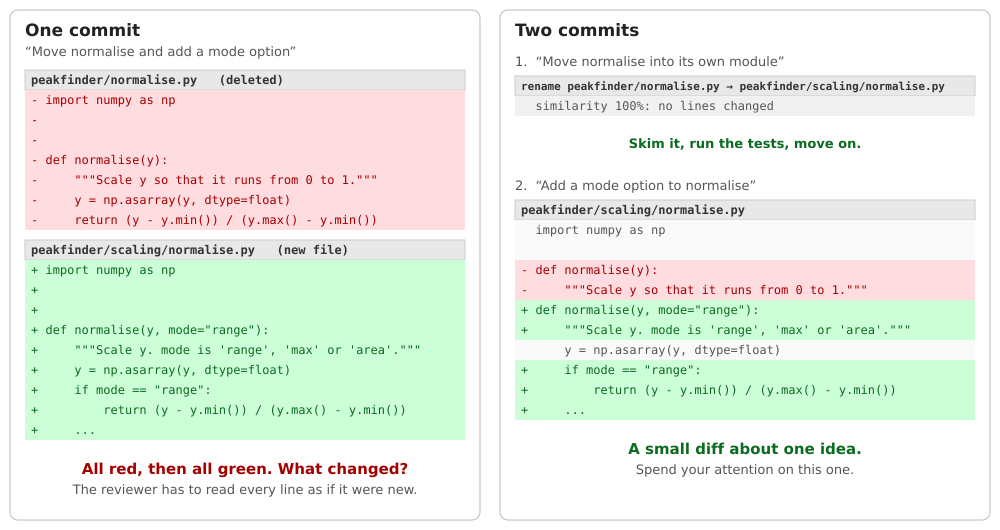

:::::::::::::::::::::::::::::::::::::: questions

- How do I plan a change before I start typing?
- What makes a commit easy to review?
- What should a commit message say?

::::::::::::::::::::::::::::::::::::::::::::::::

::::::::::::::::::::::::::::::::::::: objectives

- Sketch a commit plan for a small change
- Describe an atomic commit
- Write a commit message with a short subject and a body that says *why*
- Spot a commit that mixes unrelated changes

::::::::::::::::::::::::::::::::::::::::::::::::

## Why history matters

Think about the last time you looked back through a project's history. You might have been:

- trying to work out **why** a line is the way it is
- hunting for **when** something broke
- **reviewing** a colleague's changes
- copying a fix onto another branch

Every one of those jobs is easier if the history was written for a reader. Everything else in this
workshop is a tool for doing that. First we need to know what we are aiming at.

## Plan the work, then the commits

Most people start a piece of work by opening a file and typing. Try this instead. Before you write any code, spend a couple of
minutes on two questions.

**1. What is the overall change you want to make?**

Say it in one sentence, and say what "done" looks like. For example:

> *"Peaks that are lower than a minimum height should be ignored, because our example data reports 71 peaks when only three
> are real."*

If it takes a paragraph, or a lot of "and"s, the change is probably too big for one branch. Split it up now.

**2. What changes are needed along the way?**

List the steps it takes to get there. Any step that can stand on its own is a candidate for a commit. For the example above:

```
1. Add a min_height option to find_peaks
2. Add tests for min_height
3. Add a --min-height option to the command line
```

That list is your **commit plan**. It:

- tells you whether the change is **small enough**. If you've written ten steps, the work should probably be split into two branches.
- gives each step a **name** before you've started, which makes the commit message easy later
- helps you notice what's **missing**, like the tests or the command line

::::::::::::::::::::::::::::::::::::: callout

## The plan is a guess

You will get it wrong, and that is fine. You might find a bug that has to be fixed first, or
realise step 2 should come before step 1. Update the plan and carry on. We'll cover how to put
commits in the right order after the fact, so a wrong plan costs you very little.

The point isn't to follow the plan exactly. It's to stop yourself producing one giant lump of work.

If you've come across them, this is the same instinct as slicing a big task into small stories
in an agile team: the smaller the piece, the easier it is to plan, do and review.

::::::::::::::::::::::::::::::::::::::::::::::::

## What is an atomic commit?

An **atomic commit** is one complete, logical change. It:

- does **one thing**, so you can describe it in one sentence **without using "and"**
- leaves the project **working**: the tests pass at that commit, not just at the end of the branch
- can be **understood on its own**, and could be undone or copied elsewhere without dragging other changes along

"Atomic" doesn't mean "tiny". A commit that adds a function **and its tests** can be perfectly atomic. A
one-line commit that fixes a bug *and* renames a variable is not.

```
Not atomic:   "Fix normalise and add background subtraction and update README"
Atomic:       "Handle constant spectra in normalise"
              "Add rolling minimum background subtraction"
              "Document --subtract-background in the README"
```

### Why bother?

These commits pay off throughout the workshop, and long after:

| When you... | atomic commits mean... |
|---|---|
| **review** a branch's pull request | you can read one idea at a time |
| **revert** a mistake | you can undo just the bad bit |
| **cherry-pick** a fix onto a release | you can take the fix and nothing else (episode 13) |
| **bisect** to find a bug | the commit that introduced a problem is one small commit, not a large lump (episode 10) |

::::::::::::::::::::::::::::::::::::: callout

## An example: keep the refactor apart from the change

Imagine you need to change what a function returns, and the code is in an awkward place, so you also move it into a new file and reorganise it as you go. Here is the same work as one commit, and as two:

{alt='Two panels. On the left, one commit: the old file is shown entirely in red and the new file entirely in green, so you cannot see what changed. On the right, two commits: the first is a pure move with no changed lines, and the second is a small diff showing only the real change.'}

As **one commit**, the reviewer can't tell what was *moved* and what was *changed*, so they have to read all of it as if it were new code. As **two commits**, the first is a pure refactor they can skim, check the tests still pass, and move on. The second is a small diff about the one thing that really changed.
They can trust that the first commit is boring, and spend their attention on the second.

::::::::::::::::::::::::::::::::::::::::::::::::

::::::::::::::::::::::::::::::::::::: callout

## We're not being obsessed

Nobody will mind if a commit is slightly more or less than one thing. The aim is that a
reviewer can follow your reasoning. When you're not sure, ask: *if this commit turns out to be wrong,
would I want to throw away all of it?*

::::::::::::::::::::::::::::::::::::::::::::::::

## A good commit message

Here is a message from the `peakfinder` history:

```
Add mode option to normalise

Adds 'max' and 'area' modes alongside the default 'range'.
```

A good message has:

1. A **subject line**: short (about 50 characters), in the imperative mood, as if giving an
   order. "Add", "Fix", "Remove", not "Added" or "Adds". A handy test: *"If applied, this commit will ... [subject]"*.
2. A **blank line**.
3. An optional **body**, for anything the subject can't say. Explain **why**, because the diff already shows *what*.

Most commits need only a subject. Use the body when the reason isn't obvious from the code:

```
Handle constant spectra in normalise

A flat spectrum has max equal to min, so we were dividing by zero.
Return zeros instead.
```

Compare these:

| Weak | Better |
|---|---|
| `fix` | `Fix 'range' mode of normalise for spectra that don't start at zero` |
| `updates` | `Let load_spectrum skip a variable number of header rows` |
| `wip` | *(something you'd fix before sharing, see episode 6)* |

::::::::::::::::::::::::::::::::::::: callout

## Optional: commit message prefixes

Some projects start every subject line with a short tag that says what *kind* of change it is. This makes a long `git log` easier
to scan, and it can be used to build a changelog automatically. There are two common styles:

| Kind of change | Scientific Python style (NumPy, pandas) | Conventional Commits |
|---|---|---|
| New feature | `ENH:` | `feat:` |
| Bug fix | `BUG:` | `fix:` |
| Tests | `TST:` | `test:` |
| Documentation | `DOC:` | `docs:` |
| Refactor (no behaviour change) | `MAINT:` or `REF:` | `refactor:` |
| Formatting, style | `STY:` | `style:` |

```
ENH: Add min_height option to find_peaks
BUG: Fix 'range' mode of normalise for spectra that don't start at zero
```

Neither is "right", and many projects use no prefix at all. If your project has a convention, follow it. If not, it's up to you
and your team, and it's more important to be consistent than to pick the best one. We won't use prefixes in the workshop examples.

There is a bonus: **a prefix is an atomicity check**. If you can't choose just one, such as `BUG:` or `REF:`,
you have probably got two commits.

::::::::::::::::::::::::::::::::::::::::::::::::

::::::::::::::::::::::::::::::::::::: challenge

## Knowledge check: atomic or not?

Which of these would you be happy to see as a single commit?

1. "Add `min_height` option to `find_peaks`, with tests"
2. "Fix bug in `normalise`, rename `y` to `intensity` everywhere, update README"
3. "Remove unused import from `cli.py`"
4. "Many changes"

:::::::::::::::::::::::: solution

1. Yes. The feature and its tests are one logical change.
2. No. Three unrelated changes. A reviewer has to untangle them, and if the rename causes trouble you can't undo it without undoing the bug fix.
3. Yes. Small, but it is complete and has a clear purpose.
4. No. It says nothing about what, or why.

:::::::::::::::::::::::::::::::::

::::::::::::::::::::::::::::::::::::::::::::::::

::::::::::::::::::::::::::::::::::::: challenge

## Challenge: spot the smells, and make a plan

You have been working on background subtraction for a week, and you're about to ask for a
review. Take a look at your branch:

```bash
git switch background-subtraction
git log --reverse --stat --format='%h %s' main..
```

```output
cd6792e add background module
 peakfinder/background.py | 8 ++++++++
ead2b48 wip
 peakfinder/background.py | 9 ++++++++-
21dd6b4 tidy up
 peakfinder/io.py        | 6 +++---
 peakfinder/normalise.py | 5 ++++-
 peakfinder/peaks.py     | 2 ++
 tests/test_normalise.py | 4 ++++
 tests/test_peaks.py     | 7 +++++++
33aa1de fix
 peakfinder/background.py | 4 ++--
...
```

(Use the arrow keys to scroll, and `q` to quit.)

Work with the person next to you, and *don't* run any more git commands that change things. Just read, and answer:

1. Which commits have messages that tell you nothing?
2. Which commit mixes unrelated changes? How can you tell?
3. Which commits are really corrections to an earlier commit, or shouldn't be in the history at all?
4. **Write down the list of commits you wish the branch contained.** In episode 6 you'll turn this branch into your list.

Tip: `git show <hash>` shows what a commit actually changed, and the Source Control view and
Timeline in VS Code are another way of browsing it.

:::::::::::::::::::::::: solution

1. `wip`, `tidy up`, `fix`, `cli stuff`, `fix typo`, `readme`, `add tests` and `add background module` all say little or nothing about the change.
2. `tidy up`. It touches five files and does three unrelated things:
   a fix in `normalise`, a change to `load_spectrum`, and a new check in `find_peaks`. The stat shows several files that have nothing to do with each other, and the vague message hides it.
3. `wip`, `fix`, `remove print` and `fix typo` all correct or finish the `add background module` commit. And `try smoothing` adds an experiment (`scratch_smoothing.py`) that nothing uses.
4. One sensible plan:
   1. Handle constant spectra in `normalise`
   2. Let `load_spectrum` skip a variable number of header rows
   3. Check `x` and `y` are the same length in `find_peaks`
   4. Add rolling minimum background subtraction
   5. Add tests for background subtraction
   6. Add `--subtract-background` option to the CLI
   7. Document `--subtract-background` in the README

   Yours might be slightly different (for example, you may fold the tests into commit 4), and that is OK as long as you can explain it.

That gap, between the branch you have and the list you wish you had, is what episode 6 closes.

:::::::::::::::::::::::::::::::::

::::::::::::::::::::::::::::::::::::::::::::::::

::::::::::::::::::::::::::::::::::::: instructor

Timing: about 15 minutes of talk and 10 for the challenge. The challenge is *reading only*, in pairs,
and we reuse the plan in episode 6. Keep it light: don't spend long on commit message conventions,
people have strong opinions and it is a rabbit hole. Show the table of "weak vs better" and move on.

Possible discussion points:

- **"Should tests go in the same commit as the code?"** There are two schools of thought. Our view: yes, if a
  commit changes behaviour, the test for it belongs with it, so every commit stands alone. But a separate
  test commit is fine, and our messy branch has one.
- **"This is too much work."** Answer: you will write less *time* worth of commit message than you save in review.
  And episodes 5 to 7 show how to get there without planning perfectly.
- **"What about squash merging? Doesn't that make this pointless?"** Squash is a good fallback when a
  branch has *not* been curated, but it throws away exactly the story we're trying to tell.
  We'll come back to this in episode 9.

Make sure everyone writes the plan down (a text file or paper). They'll need it in episode 6.

::::::::::::::::::::::::::::::::::::::::::::::::

::::::::::::::::::::::::::::::::::::: keypoints

- Plan your commits before you start: a short list keeps each change small
- An atomic commit does one logical thing and leaves the project working
- A commit message has a short imperative subject, and a body that says *why* when it isn't obvious
- Atomic commits make review, revert, cherry-pick and bisect much easier

::::::::::::::::::::::::::::::::::::::::::::::::
