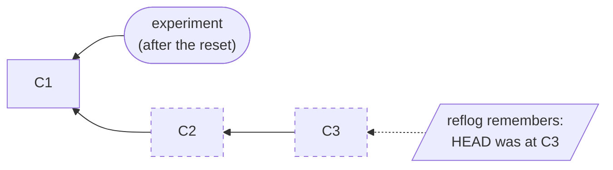

:::::::::::::::::::::::::::::::::::::: questions

- How do I undo a mistake in git?
- Can I really lose work?

::::::::::::::::::::::::::::::::::::::::::::::::

::::::::::::::::::::::::::::::::::::: objectives

- Read the reflog
- Recover from a bad `git reset --hard`
- Bring back a deleted branch
- Know what the reflog can't save

::::::::::::::::::::::::::::::::::::::::::::::::

## Why now?

From the next episode on we will be *changing history*: amending, resetting and rebasing. If that sounds
risky, this episode is the reason it isn't. Git keeps a private diary of where you've been, and it can
get you back.

Remember from episode 2: when you "change" a commit, git makes a new one and moves a label. The old commit
is still there, but nothing points at it any more. The reflog is how you find it again.

## What is the reflog?

Every time `HEAD` moves (when you commit, switch branch, reset, rebase, merge...) git writes a line
in a log. See yours:

```bash
git reflog
```

```output
1e81f27 HEAD@{0}: checkout: moving from experiment to main
fba8092 HEAD@{1}: reset: moving to HEAD@{1}
1e81f27 HEAD@{2}: reset: moving to HEAD~2
fba8092 HEAD@{3}: commit: Note gaussian fitting idea in README
1634522 HEAD@{4}: commit: Note smoothing idea in README
...
```

(Use `q` to leave the pager.) Yours will look different, as it's a record of *your* actions.

Each line says: the commit `HEAD` pointed to, `HEAD@{n}` (that position, counting back from now), and what
you did to get there. The newest entry is at the top.

The reflog is:

- **local**: it lives in your clone and is never pushed. Your colleagues have their own.
- **temporary**: entries expire. By default after 90 days, or 30 days if the commit is no longer on any branch.
- **only about commits**. Remember that last point, we'll come back to it.

## Oh no: a bad reset

Let's make some work and then destroy it. **Follow along with the instructor, and type each step yourself.** Make a throwaway branch and two commits:

```bash
git switch -c experiment
echo "- Idea: smooth the spectrum before peak finding" >> README.md
git commit -am "Note smoothing idea in README"
echo "- Idea: fit gaussians to the peaks" >> README.md
git commit -am "Note gaussian fitting idea in README"
git log --oneline -3
```

```output
fba8092 Note gaussian fitting idea in README
1634522 Note smoothing idea in README
1e81f27 Add plotting of the spectrum and its peaks
```

Now the mistake. You meant to undo one commit, but you typed a `2` and also added `--hard`:

```bash
git reset --hard HEAD~2
```

```output
HEAD is now at 1e81f27 Add plotting of the spectrum and its peaks
```

Both commits seem to be gone, and the lines have vanished from `README.md`. (We'll explain exactly what
`reset` does in the next episode. For now: it moved the branch label back two commits and threw away the
changes.)

Don't panic. Look at the reflog. (The hashes in our examples will be different from yours, because they depend on the
time you made the commits. Always use the ones on *your* screen.)

```bash
git reflog
```

```output
1e81f27 HEAD@{0}: reset: moving to HEAD~2
fba8092 HEAD@{1}: commit: Note gaussian fitting idea in README
1634522 HEAD@{2}: commit: Note smoothing idea in README
1e81f27 HEAD@{3}: checkout: moving from main to experiment
...
```

The line `fba8092 HEAD@{1}: commit: Note gaussian fitting idea in README` is where we were before the reset.



*Dashed commits still exist, but no branch points at them. The reflog is how you find your way back to one.*

Move the branch label back there:

```bash
git reset --hard fba8092
```

```output
HEAD is now at fba8092 Note gaussian fitting idea in README
```

Both commits are back, and so is the file's content.

::::::::::::::::::::::::::::::::::::: callout

## Use the hash, not `HEAD@{n}`

You can write `git reset --hard HEAD@{1}`, and it often works. But the numbers **shift every time `HEAD`
moves**, including when you run the recovery commands. Read the reflog and copy the **hash** of the line
you want. It never changes.

::::::::::::::::::::::::::::::::::::::::::::::::

::::::::::::::::::::::::::::::::::::: callout

## A quicker undo: `ORIG_HEAD`

Before risky commands such as `reset`, `merge` and `rebase`, git remembers where you were in `ORIG_HEAD`.
So straight after a mistake, `git reset --hard ORIG_HEAD` often puts you back. The reflog covers
the cases where you've done other things since.

::::::::::::::::::::::::::::::::::::::::::::::::

## Oh no: a deleted branch

Delete the branch (we have to switch away first, and `-D` forces deletion of unmerged work):

```bash
git switch main
git branch -D experiment
```

```output
Deleted branch experiment (was fba8092).
```

Look: git even tells you the hash. If you missed that, the reflog still has it:

```bash
git reflog
```

Find the last commit of the branch (the line that says `commit: Note gaussian fitting idea in README`)
and make a new label there:

```bash
git branch experiment fba8092
git log --oneline experiment -3
```

The branch is back, with both commits. Now tidy up:

```bash
git switch main
git branch -D experiment
```

## What the reflog can't save

The reflog records *commits*. Work that was never committed isn't in it:

- Edits you made and never committed, then threw away with `git restore .` or `git reset --hard`: **gone**.
- Edits you staged but never committed: usually gone too (technically git may keep the content, but
  finding it is painful).
- Anything older than the expiry time.
- Commits only ever made on someone else's computer.

The rule that follows: **commit before you try something risky**. Even a messy "wip" commit, which we know how to
tidy up afterwards. A commit can be recovered, and an uncommitted edit cannot.

::::::::::::::::::::::::::::::::::::: challenge

## Knowledge check: can I get it back?

For each situation, can you get the work back? How?

1. You committed three times on a branch, then ran `git reset --hard main`.
2. You edited `peaks.py`, never committed, and ran `git restore peaks.py`.
3. You ran `git branch -D feature` before it was merged.
4. You did an interactive rebase last week and now realise you dropped a commit you needed.

:::::::::::::::::::::::: solution

1. **Yes.** Find the last of the three commits in `git reflog` and `git reset --hard <hash>`.
2. **No.** The changes were never committed, so git has no record of them.
3. **Yes.** `git branch -D` prints the hash of the tip, and the reflog has it too: `git branch feature <hash>`.
4. **Yes**, as long as it's within the expiry (90 days / 30 days). The reflog shows where the branch was before the
   rebase. Look for the `rebase (start)` entry and the one before it. This is why we'll be relaxed about rebasing.

:::::::::::::::::::::::::::::::::

::::::::::::::::::::::::::::::::::::::::::::::::

::::::::::::::::::::::::::::::::::::: instructor

**Pacing.** This episode *is* the follow-along: learners type every step with you, so go slowly and pause after each command until people have caught up. There's no separate challenge. If someone falls behind, they can watch and catch up at the knowledge check.

Do the "oh no" moments as a live demo with everyone following. The drama is the point: say *"I've
lost all my work!"* and pause before looking at the reflog.

Cleanup: make sure everyone ends the episode with `main` checked out, and with a clean `git status`. A bad
`README.md` change left on `main` would cause confusing conflicts later. If anyone committed to
`main` by mistake: `git reset --hard origin/main` (they have a fork, so it will be at the right place).

VS Code has no built-in reflog view. (The GitLens extension adds one.) This is a terminal job.

Common problems:

- The reflog opens in a pager and people don't know how to leave. It's `q`.
- Someone runs `git reset --hard` with uncommitted work, and asks about it. Use it as the live
  demonstration of "what the reflog can't save".

::::::::::::::::::::::::::::::::::::::::::::::::

::::::::::::::::::::::::::::::::::::: keypoints

- Git rarely deletes commits straight away. The reflog records where `HEAD` has been, so you can find them
- Recover by copying the hash from `git reflog` and using `git reset --hard <hash>` or `git branch <name> <hash>`
- The reflog is local and expires, and doesn't cover uncommitted work
- Commit before trying something risky

::::::::::::::::::::::::::::::::::::::::::::::::
