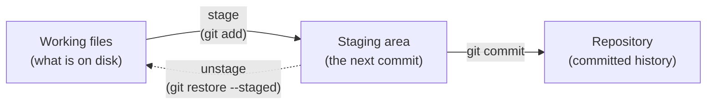
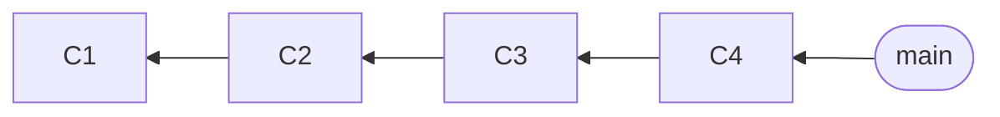
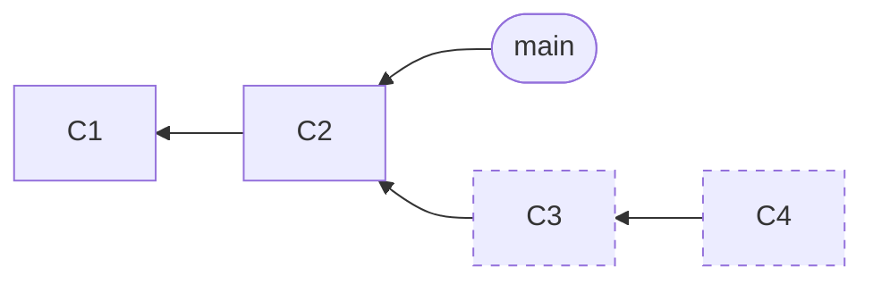

:::::::::::::::::::::::::::::::::::::: questions

- How do I commit only *part* of my changes?
- How do I fix the commit I just made?
- What do `reset` and `restore` do?

::::::::::::::::::::::::::::::::::::::::::::::::

::::::::::::::::::::::::::::::::::::: objectives

- Stage individual hunks and lines using the VS Code Source Control view
- Amend the last commit, to change its message or add to it
- Describe what `git reset --soft`, `--mixed` and `--hard` each move
- Discard or unstage changes with `git restore`

::::::::::::::::::::::::::::::::::::::::::::::::

<!--
Primary method: VS Code Source Control UI (instructor's own preference). Show the CLI equivalent
for every action, but keep it short. `git add -p` is a sidebar, not the main event.
FIXME: add screenshots of the Source Control view (diff editor with "Stage Selected Ranges").
-->

## The staging area is a drafting table

You know the three places a change can be:



The staging area (also called the *index*) is where you **assemble** the next commit. It's the feature that
makes atomic commits possible: you don't have to commit everything you changed. You choose.

Most beginners stage whole files. But often *one file* contains *two ideas*. You can stage parts of a file as well.

## Staging parts of a file in VS Code

Open the **Source Control** view: click the branch icon in the left sidebar, or press `Ctrl+Shift+G`
(`Cmd+Shift+G` on a Mac).

Every changed file is listed. Click one, and VS Code shows a **side-by-side diff**: the old version on the left and
your working copy on the right.

Now you can stage *part* of it:

1. **Select** some lines in the diff, on the right-hand side. Click and drag, or click one line.
2. **Right-click** and choose **Stage Selected Ranges**.

Only those lines go into the staging area. The file now appears in *both* lists: *Staged Changes* has the part
you picked, and *Changes* has the rest.

You can also:

- Use the **Stage** and **Revert** buttons in the **gutter** of the diff editor (next to your selection or a change),
  to stage or revert just those lines, or a whole block (a *hunk*), in one click.

Commit as usual: type the message in the box at the top of the Source Control view and press `Ctrl+Enter`.

### Changed your mind? Unstage versus discard

These two sound alike, and they are very different:

| I want to... | VS Code | Command |
|---|---|---|
| **Unstage**: keep my edits, but leave them out of the next commit | click the **`-`** icon, or select lines and **Unstage Selected Ranges** | `git restore --staged <file>` |
| **Discard**: throw my edits away, **for good** | right-click the file, **Discard Changes** (or select lines and **Revert Selected Ranges**) | `git restore <file>` |

Unstaging is always safe. Discarding isn't: uncommitted edits aren't in the reflog (episode 4), so there's no way back. (Older guides use `git checkout -- <file>` and `git reset <file>` for these. They do the same thing, but `restore` has a clearer name.)

::::::::::::::::::::::::::::::::::::: callout

## The command line version: `git add -p`

You may see this in documentation, or need it over `ssh` where there is no VS Code:

```bash
git add -p peakfinder/plot.py
```

Git shows one hunk at a time and asks what to do:

```output
@@ -2,22 +2,24 @@ ...
-def draw(ax, x, y, peaks):
+def draw(ax, x, y, peaks, title=None):
...
(1/1) Stage this hunk [y,n,q,a,d,s,e,?]?
```

| Key | Meaning |
|---|---|
| `y` | stage this hunk |
| `n` | don't stage it |
| `s` | **split** it into smaller hunks |
| `e` | edit the hunk by hand |
| `q` | quit |
| `?` | help |

It does the same thing as the VS Code view. Use whichever you find clearer. We'll use VS Code in this workshop,
because you can see the whole file and the context while you decide.

::::::::::::::::::::::::::::::::::::::::::::::::

## Fixing the last commit: amend

You've just committed, and you notice a typo in the message. Or you forgot to include a file. Instead of making a
"fix typo" commit, you can **amend** the last one.

**VS Code:**

- To change the *message* or to *add* more changes: stage what you want to add, then open the **dropdown arrow on the Commit button**
  and choose **Commit (Amend)**. (The same thing is under the **`...`** menu, then **Commit**, then **Commit Staged (Amend)**.)

**Command line:**

```bash
git commit --amend                  # change the message (opens your editor)
git commit --amend --no-edit        # add staged changes, keep the message
```

Remember episode 2: the amended commit is a **new commit** with a new hash. The old one is still in the reflog. So only
amend commits you haven't shared with anyone. (Amend only works on the **last** commit. For an earlier one, you'll use `--fixup` and interactive rebase, in episodes 6 and 7.)

## Moving where you are: reset

`git reset` moves the **branch label** (and `HEAD` with it) to another commit. We saw in episode 2 that a
branch is just a label, so this is simple to picture.

**Before:**



**After `git reset HEAD~2`:**



*Dashed commits still exist, but no branch points at them. Older commits are on the left.*

What happens to your files? That depends on the **mode**:

| Command | Branch label | Staging area | Working files |
|---|---|---|---|
| `git reset --soft <commit>` | moves | **kept** (the undone changes stay staged) | kept |
| `git reset --mixed <commit>` (the default) | moves | **reset** (the undone changes are unstaged) | kept |
| `git reset --hard <commit>` | moves | reset | **reset: your changes are lost** |

In plain words:

- **soft**: "undo the commit, but keep all the changes ready to commit again"
- **mixed**: "undo the commit, and keep the changes, but I'll choose what to stage again"
- **hard**: "throw it all away" (the dangerous one)

You'll use **mixed** all the time in this workshop. It means: take this commit apart so I can build it again,
better.

### Resetting in VS Code

VS Code doesn't have a button for each mode, but you can build all three from its buttons. Start from the Source Control view:

| You want | Click | Same as |
|---|---|---|
| **soft**: undo the last commit, keep the changes staged | `...` menu, **Commit**, **Undo Last Commit** | `git reset --soft HEAD^` |
| **mixed**: undo the last commit, keep the changes unstaged | **Undo Last Commit**, then **Unstage All Changes** (the `-` next to *Staged Changes*) | `git reset HEAD^` |
| **hard**: undo the last commit and throw its changes away | **Undo Last Commit**, then **Discard Changes** on each file (right-click a file under *Changes*, it asks you to confirm) | `git reset --hard HEAD^` |

(Undo Last Commit and Discard Changes are in VS Code's own documentation. The buttons that act on a whole list at once, such as *Unstage All Changes*,
appear when you hover over the *Staged Changes* header.)

<!-- FIXME: add screenshots, and check the header buttons in the VS Code version we ask learners to install. -->

### Resetting on the command line

The commands in the table above are all you need: add `HEAD^` (or `HEAD~1`, "the commit before this one") to go back one commit, or `HEAD~3` to go back three. Unlike the buttons, the command line can move the branch to **any** commit
(`git reset --hard <hash>`, as we did in episode 4).

::::::::::::::::::::::::::::::::::::: challenge

## Knowledge check: which reset?

Which mode would you use if you wanted to:

1. Undo your last commit but keep every change staged, so you can fix the message and recommit?
2. Undo your last commit and unstage everything, so you can split it into two commits?
3. Throw away your last commit **and** all the work in it? (Think carefully!)

:::::::::::::::::::::::: solution

1. `--soft`
2. `--mixed` (the default)
3. `--hard`. Only if you're sure! If you aren't, commit the work to a new branch first, or remember that the reflog
   can find the commit again (episode 4).

:::::::::::::::::::::::::::::::::

::::::::::::::::::::::::::::::::::::::::::::::::

::::::::::::::::::::::::::::::::::::: challenge

## Challenge: untangle a commit

It's the end of a long day, and you have committed everything in one go. Your branch `untangle` has a single commit,
badly named `plot stuff`. It contains **three different things**:

1. A new feature: a `--title` option so you can put a title on the plot (changes in `cli.py` and `plot.py`)
2. A small fix: the red peak markers were hiding behind the line, so they're now drawn on top (one line in `plot.py`)
3. A leftover **debug print** in `cli.py` that should never be committed

Your job is to turn it into **two** clean commits, with the debug print gone:

1. `Add --title option for the plot`
2. `Draw peak markers on top of the line`

Steps:

1. Switch to the branch and look at the commit.

   ```bash
   git switch untangle
   git show --stat
   ```

2. Take the commit apart so the changes are in your working files, but not staged. (Which reset mode? Which
   buttons?)
3. Use the Source Control view to **stage only the title feature**, and commit it.
4. **Stage the marker fix** and commit it.
5. **Discard the debug print.**

Check your work:

```bash
git log --oneline -3
git show --stat HEAD~1
git show --stat HEAD
git grep DEBUG
pytest
python -m peakfinder.cli data/example_spectrum.csv --save-plot title.png --title "Example"
```

You should see two new commits, the first touching `cli.py` and `plot.py`, the second only `plot.py`. `git grep DEBUG`
should print nothing, the tests should pass, and `title.png` should have a title.

Hints:

- In the diff editor, select a **range of lines** and use *Stage Selected Ranges*. You don't have to stage whole files.
- The title feature is spread over **several places** in both files. The easiest way to find them all: the lines that
  mention `title`.
- Anything you leave unstaged stays in your working files, so it's easy to do things in the right order.

:::::::::::::::::::::::: solution

**Take the commit apart.** A mixed reset keeps the changes in your files but unstages them. In VS Code, click `...`,
**Commit**, **Undo Last Commit**. The changes appear under *Staged Changes*, so click **Unstage All Changes**.
(Or in the terminal:)

```bash
git reset HEAD^
git status --short
```

```output
 M peakfinder/cli.py
 M peakfinder/plot.py
```

**Commit 1: the feature.** In the Source Control view, open `cli.py`. In the diff, select the line
`parser.add_argument("--title", ...)`, right-click, **Stage Selected Ranges**. Do the same for the two changes that
pass `title=args.title` to `plot_spectrum`. **Don't** stage the line starting `print("DEBUG"`.

Open `plot.py`. Stage every change that mentions `title`: the extra parameter on `draw`, the `if title:` lines,
the extra parameter on `plot_spectrum`, and both calls to `draw`. **Don't** stage the one line with `zorder=3`.

Type the message `Add --title option for the plot` and press `Ctrl+Enter`.

**Commit 2: the fix.** `plot.py` now only has the `zorder=3` line left. Stage the file (click the `+`), and commit it as
`Draw peak markers on top of the line`.

**Discard the debug print.** `cli.py` has one change left, the DEBUG print. Click **Discard Changes** next to it.

**Command line version** (for reference):

```bash
git add -p peakfinder/cli.py       # answer: s, y, n, y
git add -p peakfinder/plot.py      # answer: s, y, n, y, y, y, y
git commit -m "Add --title option for the plot"

git add peakfinder/plot.py
git commit -m "Draw peak markers on top of the line"

git restore peakfinder/cli.py
```

The `s` splits a big hunk up, and the `n` in the middle skips the `zorder` change in `plot.py`. In `cli.py` it skips the debug print.

:::::::::::::::::::::::::::::::::

::::::::::::::::::::::::::::::::::::::::::::::::

::::::::::::::::::::::::::::::::::::: instructor

**Demo first (about 5 minutes).** Do the first hunk of the challenge live in VS Code, so people see *Stage Selected Ranges* working:
undo the commit, stage the lines about `--title` in `cli.py`, and show the file in both the *Staged* and the *Changes* lists.
Then leave the rest to them.

Things that go wrong:

- **"Stage Selected Ranges" is greyed out.** They selected lines in the left (old) side of the diff or nothing at all. It has to be the right-hand side.
- **They stage the whole file** by clicking `+`. They can unstage it again with `-`, or **Unstage Selected Ranges** for a part.
- **They commit the debug print** and then need to remove it. Fine: it's a chance to show `git commit --amend`, or `git reset HEAD^` and again.
- **They discard something they wanted** with *Revert Selected Ranges*. If it was committed, the reflog has it. If not, it's gone.
  Use it as a reminder of episode 4.
- **VS Code shows no `...` menu or Amend option:** an older VS Code. Use the command line.

Don't skip the debrief (3 minutes). Ask: *"How did you decide which lines go in which commit?"* The answer, "by the idea
they belong to", is the skill.

The `untangle` branch is built by `tools/build_starter.py`, and is the same for everyone.

::::::::::::::::::::::::::::::::::::::::::::::::

::::::::::::::::::::::::::::::::::::: keypoints

- The staging area lets you assemble a commit. Stage hunks or individual lines in VS Code (or with `git add -p`)
- `git commit --amend` replaces the last commit, so only do it for commits you haven't shared
- `git reset` moves the branch label: `--soft` keeps changes staged, `--mixed` (default) keeps them unstaged, `--hard` discards them
- `git restore` discards edits or unstages files without moving any label

::::::::::::::::::::::::::::::::::::::::::::::::
