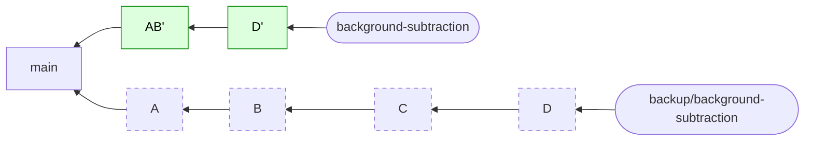

:::::::::::::::::::::::::::::::::::::: questions

- How do I reword, reorder, combine, split and drop commits?
- What does `git rebase` actually do to my commits?

::::::::::::::::::::::::::::::::::::::::::::::::

::::::::::::::::::::::::::::::::::::: objectives

- Run `git rebase -i` and use `pick`, `reword`, `drop`, `fixup` and `edit`
- Reorder commits by moving lines in the todo list
- Split one commit into several
- Explain what rebase does in terms of snapshots and new commits
- Back out of a rebase with `git rebase --abort`

::::::::::::::::::::::::::::::::::::::::::::::::

<!--
Structure (verified by script, both rebases, result identical to solution/background-subtraction):
  Rebase 1 (guided): drop, reword, reorder and fixup all in ONE interactive rebase. 10 commits -> 5.
  Rebase 2 (challenge): split `tidy up` with `edit`, and reword the three vague messages. 5 -> 7.
The starting hashes come from tools/build_starter.py and are the same for every learner. Hashes of rewritten commits differ per learner
(rebase records the current time), so we say so. If the build script changes, run tools/remap_hashes.py.
The finished todo lists are in the SOLUTION dropdowns on purpose: learners decide the verbs first.
-->

## Where we left off

For the last week you have been adding background subtraction to `peakfinder`, and you've just been told the work is ready for review. Take a look at your branch:

```bash
git switch background-subtraction
git log --oneline main..
```

The `main..` means "the commits on this branch that aren't on `main`".

```output
d8cc138 readme
9e1626f try smoothing
4244130 fix typo
2b17bef cli stuff
9a6471e remove print
89f7c6f add tests
33aa1de fix
21dd6b4 tidy up
ead2b48 wip
cd6792e add background module
```

You wrote a list in episode 3 of the commits you *wished* the branch contained. Ours was:

1. Handle constant spectra in `normalise`
2. Let `load_spectrum` skip a variable number of header rows
3. Check `x` and `y` are the same length in `find_peaks`
4. Add rolling minimum background subtraction
5. Add tests for background subtraction
6. Add `--subtract-background` option to the CLI
7. Document `--subtract-background` in the README

Compare it with yours. Today we turn the branch into that list. **None of the code changes.** We only change the *story* of how it got there.

::::::::::::::::::::::::::::::::::::: callout

## The golden rule, for now

Only rewrite history that nobody else has. This branch is only on your computer (and maybe your fork), so it's safe. We'll see what goes wrong when you rewrite shared history in episode 9.

::::::::::::::::::::::::::::::::::::::::::::::::

## First, a safety net

Before changing anything, put a label on where you are:

```bash
git branch backup/background-subtraction
```

It's a second name for the current tip (remember, a branch is just a label), so whatever happens we can get back. You also have `git rebase --abort`, which stops a rebase and puts everything back, and the reflog from episode 4.

## What does rebase do?

Rebase takes some commits and **replays them one at a time** on top of a starting point. Each replayed commit is a **new commit**, with a new hash (episode 2: a changed commit, or a changed parent, means a new hash). "Interactive" means git stops first and lets you say what to do with each commit.

**Before:**


**After `git rebase -i main`, dropping C and combining A and B:**



*Green: new commits made by the rebase. Dashed: the old commits, kept by the backup branch. Older commits are on the left.*

## The todo list

Start an interactive rebase onto `main`. That's where our branch began, so every commit on the branch since then gets replayed:

```bash
git rebase -i main
```

Your editor opens with a list of every commit on the branch. It's the **opposite order from `git log`**: the oldest is at the top, because that's the order git will replay them in.

```
pick cd6792e add background module
pick ead2b48 wip
pick 21dd6b4 tidy up
pick 33aa1de fix
pick 89f7c6f add tests
pick 9a6471e remove print
pick 2b17bef cli stuff
pick 4244130 fix typo
pick 9e1626f try smoothing
pick d8cc138 readme

# Rebase 1e81f27..d8cc138 onto 1e81f27 (10 commands)
# ...
```

Git will do the lines from top to bottom, one at a time. You change what happens by changing the **word at the start of a line**, or by **moving lines** (in VS Code, `Alt+↑` and `Alt+↓` move the current line):

| Command | What it does to the commit |
|---|---|
| `pick` | keep it as it is |
| `reword` | keep it, but let me change the message |
| `edit` | stop here so I can change the commit (or split it) |
| `squash` | merge it into the commit above it, and let me combine the messages |
| `fixup` | merge it into the commit above it, and throw away its message |
| `drop` | throw it away |

Deleting a line is the same as `drop`. For now, close the editor without changing anything: git replays all ten commits as they were, and nothing happens.

::::::::::::::::::::::::::::::::::::: challenge

## Knowledge check: which command?

For each of these, which command from the table would you use?

1. A commit message says `oops`, but the change itself is fine.
2. A commit adds a file you were only experimenting with.
3. Two commits are really one change that you made in two goes, and you only want to keep the first message.

:::::::::::::::::::::::: solution

1. `reword`
2. `drop`
3. `fixup` (or `squash` if you want to write a new message combining both)

:::::::::::::::::::::::::::::::::

::::::::::::::::::::::::::::::::::::::::::::::::

## Rebase 1: the easy fixes, all at once

We'll do this in two rebases. In the first we deal with everything that is **dropping, rewording, moving or folding in**. In the second, which is your challenge, we'll split a commit.

First, **work out what each commit really is**:

| Commit | What it really is |
|---|---|
| `add background module` | the start of the feature: a new file with a first version of the function |
| `wip` | carries on writing that function |
| `tidy up` | three unrelated fixes, nothing to do with the feature (we'll split it in the next rebase) |
| `fix` | fixes a bug in the function |
| `add tests` | tests for the function |
| `remove print` | removes a debugging `print` from the function |
| `cli stuff` | adds the `--subtract-background` option, but the message says nothing |
| `fix typo` | fixes a typo in the function's docstring |
| `try smoothing` | an experiment that nothing uses |
| `readme` | documents the new option |

::::::::::::::::::::::::::::::::::::: challenge

## Challenge: choose the commands

Now **decide a command for each**, using the table of commands above. Three things to think about:

- Which commits are just corrections that belong *inside* another commit?
- Which commit doesn't belong with the feature at all, and should come first?
- Which commit shouldn't be here, and which has a message that tells you nothing?

Then start the rebase, edit the list, and save:

```bash
git rebase -i main
```

Git will open the editor again for the `reword`, so you can type the new message. When it finishes, check your work:

```bash
git log --oneline main..
git diff --stat backup/background-subtraction
```

You should have **five** commits, and the only difference from the backup should be the file from the commit you dropped.

:::::::::::::::::::::::: solution

The finished todo list:

```
pick 21dd6b4 tidy up
pick cd6792e add background module
fixup ead2b48 wip
fixup 33aa1de fix
fixup 9a6471e remove print
fixup 4244130 fix typo
pick 89f7c6f add tests
reword 2b17bef cli stuff
pick d8cc138 readme
drop 9e1626f try smoothing
```

Why:

- `tidy up` moves to the **top**: the feature doesn't depend on it, so it comes first. It's still `pick` for now.
- `wip`, `fix`, `remove print` and `fix typo` are all corrections to `add background module`, so they sit **right under it**, as `fixup`.
- `cli stuff` is `reword`: change the message to `Add --subtract-background option to the CLI`.
- `try smoothing` is `drop`.

(We could move these commits because they changed different files from the ones they jumped over. If you try to move a commit above one that changed the *same lines*, git stops with a **conflict**. Resolve it, or `git rebase --abort` and rethink the order.)

The result (your hashes will be different from ours):

```output
d71e0a5 readme
bddb2b7 Add --subtract-background option to the CLI
4d0a337 add tests
2383a68 add background module
734a867 tidy up
```

```output
 scratch_smoothing.py | 5 -----
 1 file changed, 5 deletions(-)
```

:::::::::::::::::::::::::::::::::

::::::::::::::::::::::::::::::::::::::::::::::::

::::::::::::::::::::::::::::::::::::: callout

## squash or fixup?

`squash` does the same as `fixup`, but opens an editor so you can write a message that combines both. Use `fixup` when the later commit is just a correction, and `squash` when both commits have something worth saying.

::::::::::::::::::::::::::::::::::::::::::::::::

::::::::::::::::::::::::::::::::::::: challenge

## Knowledge check: where did the old commits go?

Compare `git log --oneline main..` with `git log --oneline backup/background-subtraction`.

1. Why does every commit on your branch have a new hash, even `tidy up`, which you didn't change?
2. Where have the old ten commits gone? Did `try smoothing` vanish from the repository entirely?

:::::::::::::::::::::::: solution

1. `tidy up` now sits on a **different parent** (it moved to the top, so its parent is now `main`), and rebase always makes a new commit when it replays one. A hash covers the contents *and* the parent, so the hash changes (episode 2).
2. Nothing is gone. The old commits are still there, and `backup/background-subtraction` still points at them. `try smoothing` is only out of *your* branch. It's in the reflog too (episode 4).

:::::::::::::::::::::::::::::::::

::::::::::::::::::::::::::::::::::::::::::::::::

::::::::::::::::::::::::::::::::::::: instructor

Pause here until everyone has five commits. The commonest problems are:

- The editor opened in vim (not VS Code), so `core.editor` wasn't set. Fix it with `git config --global core.editor "code --wait"`. If they are stuck in vim: `:q!` aborts the rebase step.
- Typing in the wrong order. Remember it's oldest first.
- Saving the file but not closing the VS Code tab. Git waits until the tab is closed.
- A commit moved above one that touches the same file, and a conflict. They can `git rebase --abort` and start again, with the todo list given in the solution.

::::::::::::::::::::::::::::::::::::::::::::::::

## Rebase 2: split a commit

Five commits now, and one of them is still doing too much: `tidy up`. Look at what is inside it (it's the first commit on the branch):

```bash
git show --stat HEAD~4
```

```output
commit 734a867...
Author: Sam Scientist <sam.scientist@example.org>

    tidy up

 peakfinder/io.py        | 6 +++---
 peakfinder/normalise.py | 5 ++++-
 peakfinder/peaks.py     | 2 ++
 tests/test_normalise.py | 4 ++++
 tests/test_peaks.py     | 7 +++++++
 5 files changed, 20 insertions(+), 4 deletions(-)
```

It has three unrelated fixes. A reviewer has to work out which hunk belongs to which idea.

::::::::::::::::::::::::::::::::::::: challenge

## Challenge: split a commit, and finish the messages

Using an interactive rebase and the `edit` command, split `tidy up` into these three commits:

1. `Handle constant spectra in normalise` (`normalise.py` and its test)
2. `Let load_spectrum skip a variable number of header rows` (`io.py`)
3. `Check x and y are the same length in find_peaks` (`peaks.py` and its test)

In the **same rebase**, give the other vague messages proper ones (hint: `reword`):

- `add background module` becomes `Add rolling minimum background subtraction`
- `add tests` becomes `Add tests for background subtraction`
- `readme` becomes `Document --subtract-background in the README`

Hints:

- `edit` stops the rebase *after* applying the commit. You then need to undo the commit, but keep its changes in your working files. Which reset do you want? (Episode 5: *mixed*. In VS Code, **Undo Last Commit**, then **Unstage All Changes**.)
- Stage each group of files in the Source Control view (or `git add <files>`), then commit.
- When you have made your three commits, tell git to carry on.
- `git status` tells you what to do next, at any time.

When you finish, check your work:

```bash
git log --oneline main..
git diff --stat backup/background-subtraction
```

You should have **seven** commits, and a diff that only shows `scratch_smoothing.py`.

:::::::::::::::::::::::: solution

Start the rebase. Change `pick` to `edit` for `tidy up`, and to `reword` for the three vague messages. (Use the hashes from *your* log.)

```bash
git rebase -i main
```

```
edit 734a867 tidy up
reword 2383a68 add background module
reword 4d0a337 add tests
pick bddb2b7 Add --subtract-background option to the CLI
reword d71e0a5 readme
```

Git stops at `tidy up`. The commit has been applied, and `HEAD` is that commit. Undo the commit but keep the changes:

```bash
git reset HEAD^
git status --short
```

```output
 M peakfinder/io.py
 M peakfinder/normalise.py
 M peakfinder/peaks.py
 M tests/test_normalise.py
 M tests/test_peaks.py
```

Make three commits:

```bash
git add peakfinder/normalise.py tests/test_normalise.py
git commit -m "Handle constant spectra in normalise"

git add peakfinder/io.py
git commit -m "Let load_spectrum skip a variable number of header rows"

git add peakfinder/peaks.py tests/test_peaks.py
git commit -m "Check x and y are the same length in find_peaks"
```

Carry on with the rebase. It will stop at each `reword` so you can type the new message.

```bash
git rebase --continue
```

Finally:

```bash
git log --oneline main..
```

```output
16dc9b1 Document --subtract-background in the README
5f580ee Add --subtract-background option to the CLI
0c4a936 Add tests for background subtraction
2917647 Add rolling minimum background subtraction
28ec0e5 Check x and y are the same length in find_peaks
5d3c64c Let load_spectrum skip a variable number of header rows
0e4303b Handle constant spectra in normalise
```

(Your hashes will be different.)

:::::::::::::::::::::::::::::::::

::::::::::::::::::::::::::::::::::::::::::::::::

::::::::::::::::::::::::::::::::::::: instructor

Give people about 10 to 12 minutes, then review it together. Live-demo the solution in the VS Code terminal while someone describes what they did.

Make sure nobody merges `background-subtraction` into `main` at the end. Tomorrow, `main` has to be unchanged so that the
colleague's branch can be fast-forwarded onto it (episode 9). If anyone does, `git reset --hard origin/main` on `main` puts it right.

Things that commonly go wrong:

- **Forgetting `git rebase --continue`** after the split. `git status` says "interactive rebase in progress".
- **`git reset --hard` instead of `git reset`.** The changes are gone from the working directory! Show them how to recover: `git rebase --abort`, then start rebase 2 again.
- **Staged everything in one go**, ending with a single commit again. Check with `git show --stat`.
- A **conflict** in a reword step. This shouldn't happen in this exercise. If it does, `git rebase --abort` and restart.
- **Someone who is hopelessly lost:** have them `git rebase --abort` (if in a rebase), then `git reset --hard backup/background-subtraction`, and go again from rebase 1.
  If they have no backup, a helper can give them the clean result (see the instructor guide for the rescue commands).

::::::::::::::::::::::::::::::::::::::::::::::::

## Look at the result

```bash
git log --oneline main..
```

Compare this to the log at the start of the episode, and to the list you wrote in episode 3. The code didn't change, but a reviewer can now:

- read one commit at a time, each with a single purpose
- trust the messages to say *why* the change was made
- look at the three small fixes separately from the feature

In real life, the next step would be to push this branch and open a pull request for review (we'll do that in episode 11, with a different branch). Once approved, it would be merged into `main`.

We **aren't** going to merge this one. It was practice, and tomorrow's story needs `main` to stay exactly as it is. So
leave it where it is. It has done its job.

::::::::::::::::::::::::::::::::::::: challenge

## Knowledge check: when would you not do this?

Think about these three situations. In which would you be happy to rewrite history, and in which not?

1. A branch that only exists on your laptop.
2. A branch you pushed to your fork, with an open pull request that someone has started reviewing.
3. `main` in a repository the whole team uses.

:::::::::::::::::::::::: solution

1. Happy. Nobody else is affected.
2. Careful. Possible, and quite common, but the reviewer has to be told: we'll see how to do it well
   in episode 11.
3. Never. Everybody else's copies have the old commits, and rewriting would put the team's histories out of step.

:::::::::::::::::::::::::::::::::

::::::::::::::::::::::::::::::::::::::::::::::::

::::::::::::::::::::::::::::::::::::: keypoints

- `git rebase -i <base>` lets you edit every commit on a branch since `<base>`
- The todo list is oldest first: change the command word to reword, drop, fixup or edit, and move lines to reorder
- Rebase makes new commits. The old ones remain, so a backup branch or the reflog gets you back
- Use `edit` and `git reset HEAD^` to split a commit into several
- `git rebase --abort` undoes a rebase that is going badly
- Only rewrite history that nobody else has yet

::::::::::::::::::::::::::::::::::::::::::::::::
