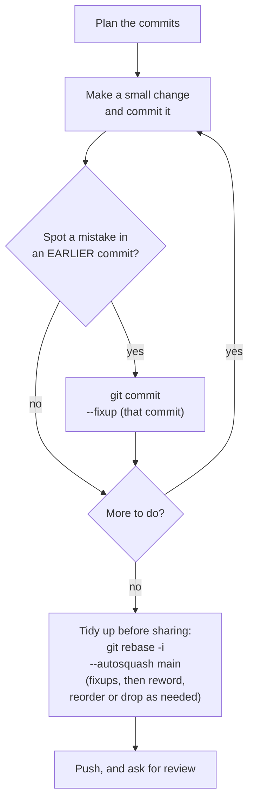
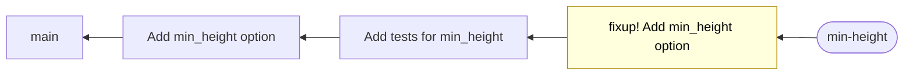
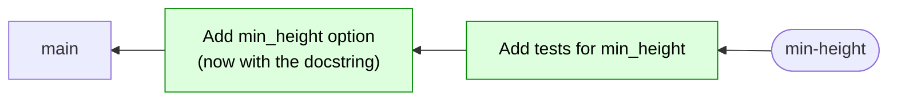

:::::::::::::::::::::::::::::::::::::: questions

- How do I keep my history clean *while* I'm still working?
- How do I fix a mistake in an earlier commit without a "fix typo" commit?

::::::::::::::::::::::::::::::::::::::::::::::::

::::::::::::::::::::::::::::::::::::: objectives

- Plan a few commits, then build a feature one atomic commit at a time
- Use `git commit --fixup` to correct an earlier commit
- Use `git rebase -i --autosquash` to fold the fixups in
- Push a tidy branch to your fork

::::::::::::::::::::::::::::::::::::::::::::::::

<!--
THE SPINE OF THE COURSE. Episode 6 was the rescue. This is the habit that stops you needing one.
Every step here was checked with a script (demo + both learner variants).
Hashes shown are illustrative: learners' will differ.
-->

## The loop

In the last episode we rescued a messy branch. That was useful, but nobody wants to do it every time.
Here is the habit that means you rarely need to:




The idea: **commit freely as you go, and tidy up before you share.** You never have to stop and
interrupt your flow to edit history. You leave a note ("this is a fix for that commit") and tidy up at the end.

## Start from a fresh branch

Always start new work from an up-to-date `main`, on a branch of its own:

```bash
git switch main
git status                      # should say "nothing to commit, working tree clean"
git switch -c min-height
```

(`git switch -c` creates the branch **and** moves you onto it. In real life you'd `git pull` first, and your `pull.rebase true` setting means that keeps history linear too.)

## Plan

Remember episode 3? First, **the overall change**, in one sentence: *"Ignore peaks that are lower than a minimum height, because
our example data reports far too many."* Then **the steps along the way**, which is our commit plan:

```
1. Add a min_height option to find_peaks
2. Add tests for min_height
```

Why bother? Look at what the program does on our example data right now:

```bash
python -m peakfinder.cli data/example_spectrum.csv | wc -l
```

```output
71
```

71 "peaks", but there are only three real ones. The rest are noise. A minimum height will help.

## Build it

**Commit 1.** In `peakfinder/peaks.py`, add the option and use it. Only these lines change:

```python
def find_peaks(x, y, min_height=None):
    ...
        if y[i] > y[i - 1] and y[i] > y[i + 1]:
            if min_height is None or y[i] >= min_height:
                peaks.append((x[i], y[i]))
```

```bash
git commit -am "Add min_height option to find_peaks"
```

**Commit 2.** Add a test at the end of `tests/test_peaks.py`:

```python


def test_min_height_ignores_small_peaks():
    x = [0, 1, 2, 3, 4, 5, 6]
    y = [0, 3, 0, 1, 4, 1, 0]
    assert find_peaks(x, y, min_height=3.5) == [(4, 4)]
```

```bash
pytest
git commit -am "Add tests for min_height"
```

## Read your own work, and leave a note

Before you share a branch, **review it yourself, the way a reviewer will**. In VS Code, open the **Source Control** view and look at the **Graph**
section (below the lists of changes). It shows the commits on your branch. Click one to see which files it touched, and click a file
to see that commit's changes by themselves. (On the command line: `git log --oneline main..` and `git show <hash>`.)

Looking at commit 1, you notice something: **the function's docstring doesn't mention the new option.** That's a correction to commit 1, not a new idea, and it shouldn't be a commit of its own on the end. Edit the docstring in `peaks.py`:

```python
    """Return a list of (position, height) for each local maximum in y.

    Peaks lower than min_height are ignored, if it is given.
    """
```

`git commit --fixup <commit>` makes a new commit whose message is `fixup! ` followed by the subject of the commit it corrects. It's a **note to your future self**: *"this belongs inside that commit"*. Find the hash, stage the change
(`+` next to the file in the Source Control view), and commit it as a fixup of commit 1:

```bash
git log --oneline main..
git commit --fixup <hash of "Add min_height option to find_peaks">
git log --oneline main..
```

```output
cfcb779 fixup! Add min_height option to find_peaks
3eace0b Add tests for min_height
d1bc7ff Add min_height option to find_peaks
```

VS Code has no button for `--fixup`, so this is one of the few places we use the terminal. The pattern that works well: **stage in the Source Control view, commit in the terminal.**

## Tidy up before sharing: autosquash

When you're ready to share, you do one last interactive rebase. It has **two jobs**:

1. **Fold in the fixups**, which `--autosquash` does for you.
2. **Tidy anything else**, using the same todo list as episode 6: `reword` a message that's gone stale, `drop` a commit that
   turned out to be unnecessary, `edit` one that should be split, or move lines to reorder. Keep going until the list of commits reads well.

```bash
git rebase -i --autosquash main
```

Here is what happens to the branch:

**Before:**



**After:**



*Yellow: a fixup note. Green: new commits made by the rebase. Older commits are on the left.*

Your editor opens, and git has **already moved** the fixup under the commit it belongs to, and marked it `fixup`:

```
pick d1bc7ff Add min_height option to find_peaks
fixup cfcb779 fixup! Add min_height option to find_peaks
pick 3eace0b Add tests for min_height
```

This time there is nothing else to edit, so **just save and close**. (If your commit list needs more, this is the moment: change the words in the todo list before you save, exactly as in episode 6.)

```bash
git log --oneline main..
```

```output
37552d4 Add tests for min_height
43922bf Add min_height option to find_peaks
```

Two clean commits, in the order you planned them, and the missing docstring never appears in the history as a "fix" commit.

::::::::::::::::::::::::::::::::::::: callout

## `--autosquash` and `rebase.autoSquash`

In the setup page you set `rebase.autoSquash true`, which makes `git rebase -i` do this automatically.
Typing `--autosquash` as well does no harm, and works on a computer where the setting isn't there.

::::::::::::::::::::::::::::::::::::::::::::::::

::::::::::::::::::::::::::::::::::::: callout

## Does every commit still pass?

Remember "atomic" means each commit works on its own. You can ask git to check, by running the tests after
*every* commit of the rebase:

```bash
git rebase main --exec "pytest -q"
```

It stops at the first commit where the tests fail. This is a great final check before asking for a review.

::::::::::::::::::::::::::::::::::::::::::::::::

::::::::::::::::::::::::::::::::::::: challenge

## Knowledge check: which commit?

For each, which commit should the fix be a `--fixup` of?

1. Your three commits are *add a function*, *add the option that uses it*, *add tests*. The test shows
   a bug in the function.
2. You spot a typo in a comment you added two commits ago.
3. You forgot to update the README, which is a new thing and goes with none of your commits.

:::::::::::::::::::::::: solution

1. The commit that **added the function**. That's where the bug was born.
2. The commit **that added the comment**.
3. None of them. If it's a new, separate change, make an ordinary new commit (such as *Document the new option in the README*).
   `--fixup` is for *corrections* to earlier commits.

:::::::::::::::::::::::::::::::::

::::::::::::::::::::::::::::::::::::::::::::::::

## Push your branch

Your branch is tidy. Push it to your fork:

```bash
git push
```

Because of your `push.autoSetupRemote` setting, git creates the branch on GitHub and links it up for you. We aren't opening a
pull request yet. That's on day 2.

::::::::::::::::::::::::::::::::::::: challenge

## Challenge: your own feature

You've seen the loop with `min_height`. Now do it again, for a *different* feature. You and your partner each take one:

- **Feature A: `min_prominence`.** Only keep peaks that stand out from their surroundings. (Whoever's first name comes first alphabetically.)
- **Feature B: peak widths.** Optionally return each peak's width at half its height. (The other person.)

The code is provided below. Your job is the **workflow**, not the maths.

Start from `main`, on your own branch:

```bash
git switch main
git switch -c feature-prominence      # or feature-widths
```

Your plan (write it down before you start!):

```
1. Add a helper function to peaks.py
2. Add an option to find_peaks that uses it
3. Add a test
```

Follow it, committing after each step, with a good message for each. Then, when the **test fails**,
fix the problem in the right commit using `--fixup` and `--autosquash`.

Finally, check each commit passes, and push the branch.

---

### Feature A: prominence

**Commit 1.** Add this to the **end** of `peakfinder/peaks.py`. Commit message: `Add prominence function`

```python


def prominence(y, i):
    """Height of the peak at i above the higher of the valleys either side."""
    left_min = y[i]
    for j in range(i - 1, -1, -1):
        if y[j] > y[i]:
            break
        left_min = min(left_min, y[j])
    right_min = y[i]
    for j in range(i + 1, len(y)):
        if y[j] > y[i]:
            break
        right_min = min(right_min, y[j])
    return y[i] - min(left_min, right_min)
```

**Commit 2.** Change `find_peaks` in the same file. The signature gets a new option, and the `append` is wrapped in a check:

```python
def find_peaks(x, y, min_prominence=0):
    ...
        if y[i] > y[i - 1] and y[i] > y[i + 1]:
            if prominence(y, i) >= min_prominence:
                peaks.append((x[i], y[i]))
```

Commit message: `Add min_prominence option to find_peaks`

**Commit 3.** Add this test to the end of `tests/test_peaks.py`. Commit message: `Add tests for min_prominence`

```python


def test_min_prominence_ignores_bumps_on_a_slope():
    x = list(range(8))
    y = [0, 5, 4, 4.5, 4, 3, 1, 0]
    assert find_peaks(x, y, min_prominence=1) == [(1, 5)]
```

---

### Feature B: widths

**Commit 1.** Add this to the **end** of `peakfinder/peaks.py`. Commit message: `Add peak_width function`

```python


def peak_width(x, y, i):
    """Width of the peak at i where it falls to half its height."""
    half = y[i] / 2
    left = i
    while left > 0 and y[left] >= half:
        left -= 1
    right = i
    while right < len(y) - 1 and y[right] >= half:
        right += 1
    return x[right] - x[left]
```

**Commit 2.** Change `find_peaks` in the same file. The signature gets a new option, and the `append` changes:

```python
def find_peaks(x, y, with_widths=False):
    ...
        if y[i] > y[i - 1] and y[i] > y[i + 1]:
            if with_widths:
                peaks.append((x[i], y[i], peak_width(x, y, i)))
            else:
                peaks.append((x[i], y[i]))
```

Commit message: `Add with_widths option to find_peaks`

**Commit 3.** Add this test to the end of `tests/test_peaks.py`. Commit message: `Add tests for peak widths`

```python


def test_peak_widths():
    x = [0, 1, 2, 3, 4, 5, 6]
    y = [0, 1, 4, 8, 4, 1, 0]
    assert find_peaks(x, y, with_widths=True) == [(3, 8, 2)]
```

---

### Then, for both

1. **Run `pytest` before you commit the test.** It fails. Read the failure, and think about which commit the bug came from.
2. Fix the bug. (Hint for A: the docstring says the *higher* of the two valleys. Hint for B: should the half-height
   point itself count as inside the peak?)
3. Make the **fix** a `--fixup` of the commit that introduced the bug, and commit the **test** as a normal commit.
4. Run `git rebase -i --autosquash main`, and just save the todo list.
5. Check: `git log --oneline main..` shows three clean commits, with no `fixup!`. Then `git rebase main --exec "pytest -q"` passes.
6. `git push`

:::::::::::::::::::::::: solution

**The bug.** In A, the function used `min(left_min, right_min)` and should use `max(...)`. In B, both `while` loops used `>=`
and should use `>`.

**The workflow** (A shown; B is the same with different names):

```bash
git switch main
git switch -c feature-prominence

# commit 1: paste the helper at the end of peaks.py
git commit -am "Add prominence function"

# commit 2: edit find_peaks
git commit -am "Add min_prominence option to find_peaks"

# write the test (don't commit yet)
pytest                          # fails!
# fix min -> max in prominence()
git log --oneline main..        # find the hash of "Add prominence function"
git add peakfinder/peaks.py
git commit --fixup <hash>       # the hash of commit 1
git add tests/test_peaks.py
git commit -m "Add tests for min_prominence"

git rebase -i --autosquash main # save and close the todo list
git log --oneline main..
git rebase main --exec "pytest -q"
git push
```

The log before autosquash:

```output
bb3dfef Add tests for min_prominence
59ccff4 fixup! Add prominence function
9a044d1 Add min_prominence option to find_peaks
29261e9 Add prominence function
```

and after:

```output
e6a6edb Add tests for min_prominence
20567d6 Add min_prominence option to find_peaks
535b14d Add prominence function
```

Notice the fixup crossed over commit 2 to land in commit 1, which is where the bug was.

:::::::::::::::::::::::::::::::::

::::::::::::::::::::::::::::::::::::::::::::::::

::::::::::::::::::::::::::::::::::::: instructor

**Demo (about 8 minutes, with learners following).** It's deliberately short: two commits, one docstring fixup, and the autosquash. People copy the code from the page, so the demo is about the *git*. The key moments to slow down for:

1. Spotting the missing docstring, and the thought *"this belongs to commit 1, not a new commit."* Say it out loud.
2. The `fixup!` commit at the end of the log, then the todo list with the `fixup` line *already moved* up under its commit. Pause here. People find
   this a pleasant surprise.
3. The log afterwards: no fixup, nothing to hide.

Save the time for the challenge, where they do it all themselves (and meet a bug that a test catches).

**Challenge (28 minutes).** Pairs: each person works alone on their own computer, but can ask the other.
Online: breakout rooms of two.

Common problems:

- **`git commit --fixup` with a wrong hash** (or a hash from before an earlier rebase). `git log --oneline main..` and try again.
  If the fixup is wrong, `git reset --soft HEAD^` and redo it.
- **The test doesn't fail.** They fixed the bug while writing the helper. Tell them to paste the code exactly as written.
- **B: only one `>=` fixed.** The test still fails. Both loops need changing.
- **Autosquash doesn't reorder anything.** They ran `git rebase main` without `-i` (no autosquash), or the `rebase.autoSquash`
  setting is missing. Use `git rebase -i --autosquash main`.
- **Editor doesn't open or hangs.** `core.editor` isn't `code --wait` (see setup).
- **A conflict during autosquash.** Rare here. `git rebase --abort`, and check the fixup only touches the lines it should.

**Pushing:** `git push` needs authentication to work, which was part of the setup. If someone's push fails, pair them with a
helper rather than losing time. They can still finish the exercise locally, and push later.

**End of day 1.** Before finishing, check everyone has:

- a pushed branch (`feature-prominence` or `feature-widths`) on their fork
- `main` unchanged, and a clean `git status`

Preview day 2: *"Overnight, a colleague's pull request gets merged into main. It touches the same function as yours..."*

::::::::::::::::::::::::::::::::::::::::::::::::

::::::::::::::::::::::::::::::::::::: keypoints

- Plan a few commits, then commit small changes as you go
- When you spot a mistake in an earlier commit, `git commit --fixup <commit>` leaves a note, without stopping your flow
- Before sharing, `git rebase -i --autosquash main` folds each fixup into its target, and you can also reword, reorder, drop or edit commits until the history reads well
- `git rebase main --exec "pytest -q"` checks every commit passes

::::::::::::::::::::::::::::::::::::::::::::::::
