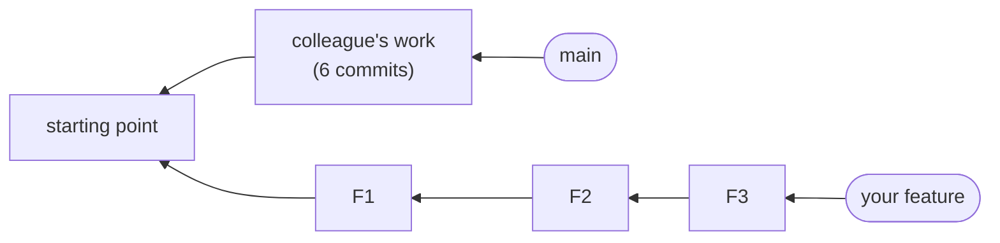
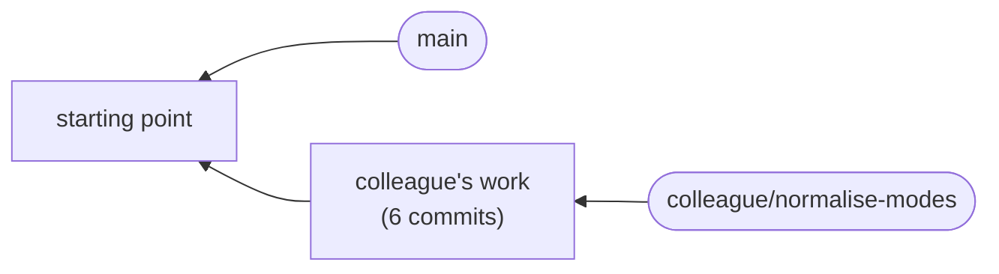
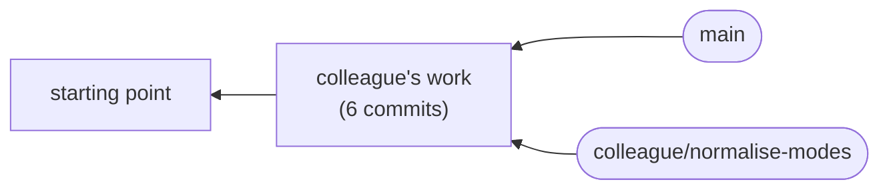
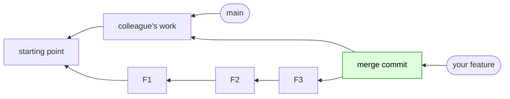
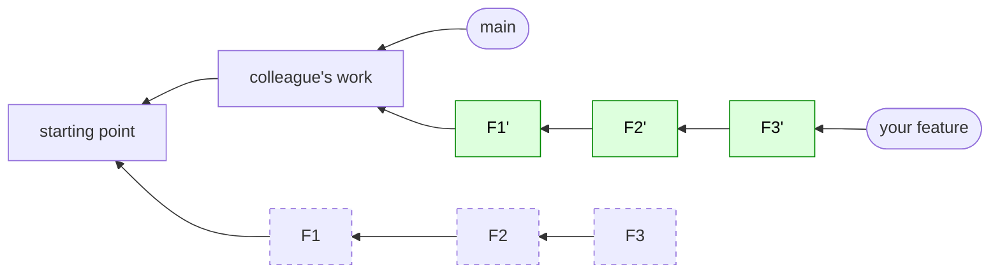

:::::::::::::::::::::::::::::::::::::: questions

- My teammate's work landed while I was working. How do I bring it into my branch?
- What is the difference between merging and rebasing?
- How do I resolve a conflict?
- Why can't I push after a rebase?

::::::::::::::::::::::::::::::::::::::::::::::::

::::::::::::::::::::::::::::::::::::: objectives

- Explain the difference between merge and rebase using diagrams
- Fast-forward `main` and see why it stays a straight line
- Bring changes from `main` into a feature branch by rebasing
- Resolve a conflict using the VS Code merge editor
- Push a rebased branch safely with `--force-with-lease`
- State the golden rule: don't rewrite history other people are using

::::::::::::::::::::::::::::::::::::::::::::::::

<!--
Verified by script for both features A and B: one conflict stop (peaks.py, the "add option" commit, two conflict blocks),
then exactly ONE failing test (test_normalise_runs_from_zero_to_one: the colleague's bug, saved for episode 10).
The colleague's Peak is a NamedTuple, so learners' tuple-based tests still pass after the rebase.
Hashes are illustrative: they will differ for learners (except the colleague's commits).
-->

## While you were working

Yesterday you built a feature on its own branch. Meanwhile, a colleague was working on the same project. Their
pull request has just been approved, and merged into `main`. Our feature branch is now based on an out-of-date `main`:



We need their changes in our branch, so that we can be sure our work fits with theirs before anyone reviews it.

First, let's **simulate their pull request being merged**. In real life GitHub does this when someone clicks the merge button. Your fork has
a branch `colleague/normalise-modes` that stands in for their work:

```bash
git fetch
git switch main
git merge --ff-only origin/colleague/normalise-modes
git push
git log --oneline --graph -8
```

```output
* 1c13652 Document Peak in the README
* b83c177 Return Peak tuples from find_peaks
* df97539 Bump version to 0.2.0
* 25dbef6 Remove unused import from cli
* e2c7538 Add mode option to normalise
* 0b83055 Fix typo in README
* 1e81f27 Add plotting of the spectrum and its peaks
* b7cf029 Add command line interface
```

This was a **fast-forward**: `main` had nothing of its own, so git simply moved the `main` label along to the colleague's last commit. No new commit was
made, and the history is still a straight line. (`--ff-only` means "do this, or refuse": it will never silently create a merge commit.)

**Before:**



**After:**



*Only the `main` label moved. Older commits are on the left.*

## Two ways to bring it in

There are two ways to get `main`'s new commits into your branch.

### Option 1: merge

```bash
git merge main
```

Git creates a **merge commit** that has two parents: the tip of your branch and the tip of `main`.



*Green: the new merge commit. Everything else was there before the merge and hasn't changed. Older commits are on the left.*

Nothing has been rewritten, and that is the merge's great strength: it's safe. But your history now splits and rejoins. Do that every time
`main` moves, and your branch fills up with "Merge branch 'main' into ..." commits that say nothing about your work. A reviewer reading
commit by commit has to read around them.

::::::::::::::::::::::::::::::::::::: callout

## Merge commits are git's default, and a fine default

Merging is what git does unless you tell it otherwise, and it's the default button on GitHub (*Create a merge commit*). For most teams it's a perfectly good default: it's safe, it never rewrites anything, and it
records exactly when branches were joined. We prefer a straight line because we want every commit to be readable one at a time, but a history with merge commits isn't wrong. Follow your team's convention.

::::::::::::::::::::::::::::::::::::::::::::::::

### Option 2: rebase

```bash
git rebase main
```

Git takes your commits one at a time and **replays** them on top of the new `main`. This is the same thing as in episode 6, but
the new starting point is different.



*Green: new commits made by the rebase. Dashed: your old commits, which nothing points at now. Older commits are on the left.*

It is as if you had started your work *after* the colleague's. History is a straight line, with your commits neatly on top.

### The difference in one sentence

> **Merge** joins the two **tips** together, and leaves a join in the history.
> **Rebase** moves the **base** (the bottom) of your branch to the tip of `main`, and leaves no trace of the move.

::::::::::::::::::::::::::::::::::::: challenge

## Knowledge check: merge or rebase?

Which one:

1. creates a new commit with two parents?
2. gives every one of your commits a new hash?
3. leaves a history that is a straight line?
4. doesn't change any existing commit?

:::::::::::::::::::::::: solution

1. **Merge**
2. **Rebase** (they are replayed on a new parent, so remember episode 2: new parent, new hash)
3. **Rebase**
4. **Merge**

:::::::::::::::::::::::::::::::::

::::::::::::::::::::::::::::::::::::::::::::::::

## Watch: what a merge does

**Your instructor will demonstrate this on screen. Watch, and follow the output below, but don't run these commands yourself.** In a few minutes you'll resolve this same conflict for real, in a rebase, and there's no
point doing it twice.

The instructor switches to a feature branch and merges `main` into it:

```bash
git switch feature-prominence
git merge main
```

```output
Auto-merging tests/test_peaks.py
CONFLICT (content): Merge conflict in peakfinder/peaks.py
Automatic merge failed; fix conflicts and then commit the result.
```

A **conflict**. Git tried to combine the colleague's changes with ours, but both of us changed the same lines of `find_peaks`, and git can't
decide whose change should win. It has stopped, and is waiting for us to decide.

## What is a conflict?

Git merges changes automatically whenever it can. A conflict happens only when two sets of changes touch the **same lines**. Git marks
the file with both versions. Open `peakfinder/peaks.py` and you'll see something like:

```
<<<<<<< HEAD
@dataclass
class Peak: ...
def find_peaks(x, y):
    """Return a list of Peak tuples, one for each local maximum in y."""
=======
def find_peaks(x, y, min_prominence=0):
    """Return a list of (position, height) for each local maximum in y."""
>>>>>>> your branch
```

Everything between `<<<<<<<` and `=======` is one side, and everything between `=======` and `>>>>>>>` is the other. To resolve a
conflict you edit the file so that it contains **what you actually want**, and delete the markers.

You *can* do that by hand in any editor. VS Code has a much friendlier way.

## Resolving a conflict in VS Code

1. Open the **Source Control** view. The conflicted file appears under **Merge Changes**.
2. Click the file, and then **Resolve in Merge Editor**.
3. The merge editor shows three panes:
   - **Incoming** (top left) and **Current** (top right): the two versions in conflict
   - **Result** (bottom): what the file will contain
4. For each conflict, use the controls next to it to accept **Incoming**, accept **Current**, or accept both, or edit the **Result** directly. Most of
   the time you want a mix of both sides, so edit the result until it's right. Check the **Result** after each choice: it tells you how
   many conflicts are still unresolved.
5. When there are none left, click **Complete Merge**. VS Code saves the file and **stages** it. (It doesn't finish the whole operation. See below.)

(You can also resolve small conflicts without the merge editor, using the **Accept Current Change** / **Accept Incoming Change** / **Accept Both Changes**
links that VS Code shows above each conflict in the file itself.)

<!-- FIXME: screenshots of the merge editor with the three panes. -->

::::::::::::::::::::::::::::::::::::: callout

## "Current" and "Incoming" swap during a rebase

In a **merge**, *Current* is **your** branch and *Incoming* is the branch you are merging **in**. That makes sense.

In a **rebase**, it's the other way round: *Current* is the branch you're rebasing **onto** (here, `main`, with the colleague's work), and *Incoming*
is **your** commit being replayed. It's confusing, but there's a reason: git is building your commits *on top of* `main`, so `main`'s version is
what's already there.

So always read the code, not the labels. Which side has the colleague's changes, and which has yours?

::::::::::::::::::::::::::::::::::::::::::::::::

### What do we want here?

Both sides made a good change. The colleague wants `find_peaks` to return `Peak` objects, and you want to add your own option. We want **both**:

- the colleague's `Peak` class and the new docstring
- *your* new parameter and your new filter, but building a `Peak` as the colleague did

In the demonstration, the instructor resolves the conflict in the merge editor, then **commits the merge**:

```bash
git commit --no-edit
git log --oneline --graph -8
```

```output
*   01eb097 Merge branch 'main' into feature-prominence
|\  
| * 1c13652 Document Peak in the README
| * b83c177 Return Peak tuples from find_peaks
| * df97539 Bump version to 0.2.0
| * 25dbef6 Remove unused import from cli
| * e2c7538 Add mode option to normalise
| * 0b83055 Fix typo in README
* | a340483 Test min_prominence
```

There is the split and rejoin. We would rather not leave that in our history, so the instructor undoes the merge.

### Undoing the merge

Before a merge, git remembered where it was in `ORIG_HEAD` (episode 4). That puts the branch back:

```bash
git reset --hard ORIG_HEAD
git log --oneline -4
```

```output
a340483 Test min_prominence
c8e1c74 Add min_prominence option to find_peaks
7c8cefd Add prominence function
1e81f27 Add plotting of the spectrum and its peaks
```

The three commits are back, exactly as they were. (If this ever doesn't work, the reflog has the answer.)

::::::::::::::::::::::::::::::::::::: challenge

## Challenge: rebase onto main

Now it's **your** turn, the other way round. You've seen how a conflict gets resolved, so this time you do it, in a rebase. Switch to your feature branch, rebase it onto `main`, and **resolve the conflict** in the merge editor.

```bash
git switch feature-prominence        # or feature-widths
git rebase main
```

Git replays your three commits. It stops at the one that conflicts (your *"Add ... option to find_peaks"* commit). Then:

1. Open the **Source Control** view and resolve `peaks.py` in the merge editor. The result must have **the colleague's `Peak` tuple and your new option**.
   There are **two** conflicts in the file, near the top and in the `if` inside the loop. (Hints are below.)
2. Click **Complete Merge**. That stages the file.
3. Tell git to carry on: `git rebase --continue` in the terminal. (VS Code's **Commit** button also continues an in-progress rebase once everything is staged.
   An editor tab may open with the commit message. Just close it.)
4. Run `git log --oneline --graph -8`: it should be a straight line, with your three commits on top of the colleague's.
5. Run the tests: `pytest`.

**Predict first:** what do you expect `pytest` to say? Then look.

Hints, for what the finished `find_peaks` needs:

- **Feature A (prominence):** keep the colleague's `Peak` class and docstring, add your `min_prominence=0` parameter, and in the loop keep your
  `if prominence(...)` check, but append `Peak(x[i], y[i])`.
- **Feature B (widths):** keep the colleague's `Peak` class and docstring, add your `with_widths=False` parameter, and in the loop keep your
  `if with_widths:` branch. In the `else` branch append `Peak(x[i], y[i])`.

If it all goes wrong, `git rebase --abort` puts everything back as it was before you started. (In VS Code: Command Palette, **Git: Abort Rebase**.)

:::::::::::::::::::::::: solution

**Feature A** (the top of `peaks.py`, and the loop):

```python
from typing import NamedTuple

import numpy as np


class Peak(NamedTuple):
    position: float
    height: float


def find_peaks(x, y, min_prominence=0):
    """Return a list of Peak tuples, one for each local maximum in y."""
    x = np.asarray(x)
    y = np.asarray(y)
    peaks = []
    for i in range(1, len(y) - 1):
        if y[i] > y[i - 1] and y[i] > y[i + 1]:
            if prominence(y, i) >= min_prominence:
                peaks.append(Peak(x[i], y[i]))
    return peaks
```

**Feature B**:

```python
def find_peaks(x, y, with_widths=False):
    """Return a list of Peak tuples, one for each local maximum in y."""
    x = np.asarray(x)
    y = np.asarray(y)
    peaks = []
    for i in range(1, len(y) - 1):
        if y[i] > y[i - 1] and y[i] > y[i + 1]:
            if with_widths:
                peaks.append((x[i], y[i], peak_width(x, y, i)))
            else:
                peaks.append(Peak(x[i], y[i]))
    return peaks
```

(with the same `Peak` class above it.)

The commands:

```bash
git rebase main
# resolve peaks.py in the merge editor, then Complete Merge
git rebase --continue
git log --oneline --graph -8
pytest
```

```output
* 8c01021 Test min_prominence
* 706f2cd Add min_prominence option to find_peaks
* cdd94be Add prominence function
* 1c13652 Document Peak in the README
* b83c177 Return Peak tuples from find_peaks
* df97539 Bump version to 0.2.0
* 25dbef6 Remove unused import from cli
* e2c7538 Add mode option to normalise
* 0b83055 Fix typo in README
* 1e81f27 Add plotting of the spectrum and its peaks
```

A straight line: the colleague's six commits, then your three.

**What does `pytest` say?** All your tests pass, but there is **one failure**:

```output
FAILED tests/test_normalise.py::test_normalise_runs_from_zero_to_one - assert...
1 failed, 8 passed
```

That's not in your code. It's in `normalise`, which you haven't touched. Something has changed in the colleague's commits that affects it, and we'll find
out what in the next episode.

:::::::::::::::::::::::::::::::::

::::::::::::::::::::::::::::::::::::::::::::::::

## Why can't I push?

Your branch is on GitHub from yesterday, with the *old* versions of your commits. Try to push the new ones:

```bash
git push
```

```output
 ! [rejected]        feature-prominence -> feature-prominence (non-fast-forward)
error: failed to push some refs to 'github.com:...'
hint: Updates were rejected because the tip of your current branch is behind
hint: its remote counterpart. If you want to integrate the remote changes,
hint: use 'git pull' before pushing again.
```

Git refuses, because the history on GitHub and the history on your computer have **diverged**. The remote has your three *old* commits, and you have
three *new* ones that are replacements. It's the picture from episode 2: a rebase makes new commits, and the old ones are still out there.

::::::::::::::::::::::::::::::::::::: callout

## Don't follow the hint!

Git suggests `git pull`. **Don't.** That would try to combine your new commits with the old ones on the remote. You'd end up with
each commit twice, or a mess of conflicts.

(We tried it. With git's default, each of your commits ends up in the history twice, and you get a conflict. With `pull.rebase true`, git tries to replay the colleague's commits on top of the old versions of yours and stops with conflicts. If you ever do it by accident,
`git merge --abort` or `git rebase --abort` puts you back, and `git reflog` can help, as in episode 4.)

::::::::::::::::::::::::::::::::::::::::::::::::

What we want is to **replace** the remote's version with ours. That is a **force push**, and it's the correct thing to do after a rebase, as long as the only
person whose work you're replacing is *you*. Use the safe version:

```bash
git push --force-with-lease
```

```output
 + a340483...36fc668 feature-prominence -> feature-prominence (forced update)
```

The difference from `--force`:

- `--force` says: *"Overwrite the remote, whatever is there."*
- `--force-with-lease` says: *"Overwrite the remote, **but only if it's still what I last saw**."*

If a teammate had pushed something to the branch since you last fetched, `--force-with-lease` would refuse, instead of silently destroying their work. So
always use it, and never plain `--force`.

::::::::::::::::::::::::::::::::::::: callout

## The golden rule

> **Only rewrite history that nobody else is depending on.**

- Your own feature branch, before anyone has built on it: **fine**.
- A branch with an open pull request: **fine, with care.** The reviewer must know. We'll cover that in episode 11.
- `main`, or any branch other people have pulled and are working on: **never**.

::::::::::::::::::::::::::::::::::::::::::::::::

## A word on linear history

Our `main` is a straight line, and so is our branch. Many teams like this because:

- `git log` reads like a story
- bisect, blame and cherry-pick are easier
- a revert undoes one thing

When you merge a pull request on GitHub, there are three buttons. (The first, *Create a merge commit*, is the default, and a fine choice if that's what your team does.)

| Button | What it does to `main` | Keeps your carefully made commits? |
|---|---|---|
| **Create a merge commit** | adds a merge commit with two parents | yes, with a join in the history |
| **Squash and merge** | squashes all your commits into one | **no**, it throws the story away |
| **Rebase and merge** | replays your commits on top of `main` | **yes**, and the history stays straight |

If you took the trouble to curate your commits, **rebase and merge** is usually what you want. Squash is a reasonable fallback for a branch
that nobody tidied up. Each team has its own policy, and it's worth finding out what yours is.

::::::::::::::::::::::::::::::::::::: callout

## Your `pull.rebase` setting

You ran `git config --global pull.rebase true` in the setup. It makes a plain `git pull` **rebase** your local commits on top, instead of creating a merge commit. That's a matter of taste (git's default is to merge), but it keeps your branch a straight line.

::::::::::::::::::::::::::::::::::::::::::::::::

::::::::::::::::::::::::::::::::::::: challenge

## Knowledge check: is it safe to rebase?

Which of these are OK to rebase and force-push (with `--force-with-lease`)?

1. `main`
2. A branch where you and your partner both push commits
3. Your own feature branch with an open pull request that nobody has reviewed yet

:::::::::::::::::::::::: solution

1. **No.** Everyone's work is based on it.
2. **Only if you tell your partner**, and they know to fetch and reset, or rebase. Otherwise they'll have the old commits and be confused. Better to agree
   a rule first.
3. **Yes.** It's your branch. If no one has started reviewing, there's nothing to disturb. (If they have, tell them. See episode 11.)

:::::::::::::::::::::::::::::::::

::::::::::::::::::::::::::::::::::::::::::::::::

<!-- Optional extras if there's time: `git merge-base main feature` (where your branch forked), `git rerere` (git remembers how you resolved a conflict). Mention only. -->

::::::::::::::::::::::::::::::::::::: instructor

**Plan (about 35 minutes).** Roughly: 10 minutes of explanation with the diagrams, 5 to fast-forward `main`, 5 for **your demonstration** of the merge (conflict, merge editor, graph, undo), 8 for the
rebase challenge on their own, and 5 for the push and the buttons. The merge is a **demo**: learners watch and don't type, so they resolve the conflict once, themselves, in the rebase. If you're
running short, skip the demo: the diagram already shows the double back.

**The demo is where you teach the merge editor.** Open it, explain the three panes, and say out loud *"which side has the colleague's change, and which has mine?"* before clicking anything. Then they do the same, alone, in the rebase.

**Roles swap in a rebase.** Current and Incoming mean the opposite of merge. This catches everyone out. Spend a minute on the callout.

**Common problems:**

- **They click "Accept Current" or "Accept Incoming"** on a whole conflict and lose half of what they wanted. Check that the result has *both* `Peak(...)` and their
  new option (`git diff main` should show their feature). `pytest` will also fail with a `NameError` or `TypeError`.
- **They leave the markers in** (`<<<<<<<`). `git diff --check` finds them.
- **They forget `git rebase --continue`**: `git status` says "rebase in progress".
- **An editor tab opens** after `--continue` (it's the commit message). Tell them to close the tab. If the editor isn't set, they get vim; see the setup page.
- **They run `git pull` after being told not to**: have them `git reflog` and reset, as in episode 4. A good chance to show it working.
- **They use `--force`** rather than `--force-with-lease`. Remind them.
- **`git merge --ff-only` refuses:** their `main` has commits of its own. `git reset --hard origin/main` first (then redo the fast-forward).
- The **one failing test** after the rebase isn't a mistake: it is the hook for episode 10. Don't explain it yet.

**If someone is hopelessly stuck:** `git rebase --abort`, and give them the resolved `peaks.py` from the solution, or have a helper pair with them.

**Bridge to episode 10:** *"We have one failing test, and it isn't in our code. What changed?"*

::::::::::::::::::::::::::::::::::::::::::::::::

::::::::::::::::::::::::::::::::::::: keypoints

- A fast-forward just moves a label, so `main` stays a straight line
- Merge joins two tips with a merge commit. Rebase moves your branch's base, and replays your commits as new ones
- A conflict means both sides changed the same lines. Resolve it by editing the result to contain what you want. The VS Code merge editor makes this easy
- In a rebase, "Current" is the branch you're rebasing onto and "Incoming" is your commit
- After a rebase, push with `--force-with-lease`. Never follow git's hint to `git pull`
- Only rewrite history that nobody else is depending on
- For pull requests, "Rebase and merge" keeps your curated commits and a straight history

::::::::::::::::::::::::::::::::::::::::::::::::
