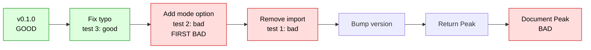

:::::::::::::::::::::::::::::::::::::: questions

- Which commit last changed this line, and what was it for?
- When did this test start failing?
- How do I fix a bug I find, without tangling the fix into my own feature?

::::::::::::::::::::::::::::::::::::::::::::::::

::::::::::::::::::::::::::::::::::::: objectives

- Use blame in VS Code to see which commit changed a line
- Use `git bisect` to find the commit where a test started failing
- Fix a bug on a separate branch, merge it into `main`, and rebase your feature onto the result

::::::::::::::::::::::::::::::::::::::::::::::::

<!--
Streamlined: blame (short), bisect (learners run `bisect run`; the by-hand version is a callout for the instructor demo), then ONE exercise for the fix.
`git log -S/-L` and the extensions are a short callout. No pull request here: the fix is fast-forwarded into main (episode 11 is the PR episode).
Everything was run by script: blame, manual bisect (3 tests), bisect run, the fix, the fast-forward, and the second rebase (no conflict, 9 tests pass).
VS Code names come from VS Code's own documentation (the history page).
Trim candidates if short of time: the by-hand bisect demo, then the log -S/-L callout.
-->

## One test is failing

At the end of the last episode we rebased onto `main` and one test failed. It isn't in our code. Run it again:

```bash
pytest tests/test_normalise.py
```

```output
>       assert np.allclose(result, [0, 0.5, 1])
E       assert False
E        +  where False = <function allclose at 0x769723b210b0>(array([-1. , -0.6, -0.2]), [0, 0.5, 1])
```

`normalise([1, 3, 5])` should give `[0, 0.5, 1]`, but it gives `[-1, -0.6, -0.2]`. This test passed at `v0.1.0`, so something changed in the colleague's six commits that affects it. Two questions: **which commit changed `normalise`**, and **when did the test start failing**?

## Which commit changed this line? Blame

Open `peakfinder/normalise.py` in VS Code. The suspicious line is in the `range` branch. `git blame` tells you **which commit last changed each line**, and its author, so you know where to look and who to ask about what the change was for.

**In VS Code:**

1. Open the Command Palette (`Ctrl+Shift+P`, or `Cmd+Shift+P` on a Mac).
2. Run **Git: Toggle Git Blame Editor Decoration**. Each line now shows its commit at the end. (**Git: Toggle Git Blame Status Bar Item** shows the commit for the current line in the status bar instead.)
3. **Hover** over the blame text to see the commit hash, message and author.

On the command line, the same information is:

```bash
git blame -L 5,12 peakfinder/normalise.py
```

```output
e2c75380 (Robin Researcher 2025-02-04 11:00:00 +0000  5)     """Scale y. mode is 'range' (0 to 1), 'max' (divide by max) or 'area'."""
b8055cf7 (Sam Scientist    2025-01-06 12:00:00 +0000  6)     y = np.asarray(y, dtype=float)
e2c75380 (Robin Researcher 2025-02-04 11:00:00 +0000  7)     if mode == "range":
e2c75380 (Robin Researcher 2025-02-04 11:00:00 +0000  8)         return (y - y.min()) / y.max() - y.min()
...
```

The suspicious line 8 comes from `e2c75380`. (`-L 5,12` means lines 5 to 12.)

::::::::::::::::::::::::::::::::::::: callout

## Other ways to look at history

- **Blame isn't proof.** It shows only the *last* change to a line. A later commit that merely re-indented the code would hide the real change. For *when* something broke, use bisect, below.
- **The Timeline view** (in the Explorer sidebar, for the open file) lists the commits that changed it. The **Source Control Graph** lists the commits on your branch: select one to see its files, and a file to see the diff.
- **`git log -S"text" -- <file>`** lists the commits that added or removed some text, and **`git log -L :<function>:<file>`** shows the history of one function.
- The **GitLens** and **Git History** extensions add richer inline blame and file history, if you like them.

::::::::::::::::::::::::::::::::::::::::::::::::

## Bisect: find when it broke

Blame told us who last touched the line. What we really want is the **first commit where the test fails**, and git can find that for us, quickly. You know a commit where the test passed (`v0.1.0`) and one where it fails (`main`). `git bisect` does a **binary search** between them: it checks out the commit in the middle, tests it, and halves the range again.



*Time runs left to right. With six commits to check it takes three tests. With 1,000 commits, it takes about ten.*

Even better, if the test can be run by a command, git can do the whole search by itself. The command should exit with 0 for "good" and non-zero for "bad", which is exactly what `pytest` does:

```bash
git bisect start main v0.1.0
git bisect run pytest -q tests/test_normalise.py
git bisect reset
```

(`git bisect start <bad> <good>`: first the bad commit, then the good one. Always finish with `git bisect reset`, which puts you back on your own branch.)

```output
e2c7538061b16250b842ab506cac3c2ae25b20c2 is the first bad commit
commit e2c7538061b16250b842ab506cac3c2ae25b20c2
Author: Robin Researcher <robin.researcher@example.org>

    Add mode option to normalise
...
bisect found first bad commit
```

::::::::::::::::::::::::::::::::::::: callout

## By hand: what bisect run is doing

Without `run`, you do the testing yourself. Your instructor will show this on screen:

```bash
git bisect start main v0.1.0       # git checks out a commit in the middle
pytest -q tests/test_normalise.py  # it fails...
git bisect bad                     # ...so tell git
pytest -q tests/test_normalise.py  # git moved to an older commit. It fails too...
git bisect bad
pytest -q tests/test_normalise.py  # older still. This one passes
git bisect good                    # git: "... is the first bad commit"
git bisect reset
```

At each step you're on a **detached `HEAD`** (episode 2): not on any branch. That's fine, as `git bisect reset` puts you back.

::::::::::::::::::::::::::::::::::::::::::::::::

::::::::::::::::::::::::::::::::::::: callout

## Why atomic commits matter here

Bisect names a **commit**. If that commit is small and atomic ("Add mode option to normalise"), you know almost exactly where the problem is. If it were a huge commit that changed 900 lines across ten files, bisect would tell you only that the problem is *somewhere* in there. This is the payoff of episode 3.

::::::::::::::::::::::::::::::::::::::::::::::::

::::::::::::::::::::::::::::::::::::: challenge

## Challenge: find the commit

1. Run the three commands above to find the commit where `test_normalise_runs_from_zero_to_one` starts to fail.
2. Open that commit (`git show <hash>`, or select it in the Source Control Graph). What exactly is wrong with the `range` line?
3. Check you're back on your feature branch: `git branch --show-current`.

:::::::::::::::::::::::: solution

1. The first bad commit is `Add mode option to normalise`.
2. In `range` mode, the code is `(y - y.min()) / y.max() - y.min()`. The brackets are wrong: it divides by `y.max()` only, and *then* subtracts `y.min()`. It should divide by
   `(y.max() - y.min())`. It only gives the right answer when the minimum is zero. The existing test would have caught it, but it looks as though
   the tests weren't run, and nothing runs them automatically. (That is what we'll fix in episode 12.)
3. `git bisect reset` returns you to your branch.

If `git bisect` complains about local changes, you have uncommitted work. Stash it (see the reference page) or commit it, and try again.

:::::::::::::::::::::::::::::::::

::::::::::::::::::::::::::::::::::::::::::::::::

## Fix it, but not here

We know what's wrong, and the fix is one line. The tempting thing is to fix it on the feature branch, as it's right there. **Don't.** The fix has nothing to do with your feature, so your pull request would mix two ideas. And if the fix is tangled up with your feature, nobody can use it without taking your feature too. We'll need exactly that in episode 13.

So put the fix on its own branch from `main`:

```bash
git switch main
git switch -c fix/normalise
```

Fix the line in `peakfinder/normalise.py`:

```python
        return (y - y.min()) / (y.max() - y.min())
```

Check it, and commit it with a message that explains **why**:

```bash
pytest
git commit -am "Fix 'range' mode of normalise for spectra that don't start at zero" -m "The division only applied to y.max(), not to (y.max() - y.min())."
```

On a real team you would open a pull request for this fix, and we'll look at doing that well in the next episode. To keep moving, we'll merge it straight into `main` now. Nothing has happened on `main` since we branched, so git can **fast-forward** it (episode 9):

```bash
git switch main
git merge --ff-only fix/normalise
git push
git branch -d fix/normalise
```

```output
Updating 1c13652..05c314d
Fast-forward
 peakfinder/normalise.py | 2 +-
 1 file changed, 1 insertion(+), 1 deletion(-)
```

Finally, your feature branch is based on a `main` that still has the bug. Rebase it again, as we did in the last episode:

```bash
git switch feature-prominence        # or feature-widths
git rebase main
pytest
git push --force-with-lease
```

```output
Successfully rebased and updated refs/heads/feature-prominence.
9 passed
```

This time **there is no conflict**, because the fix touched different lines from your feature, and every test passes.

::::::::::::::::::::::::::::::::::::: challenge

## Challenge: fix the bug on its own branch

Do the whole thing yourself:

1. Create `fix/normalise` from `main`, fix the bug, and commit it with a good message.
2. Fast-forward `main` to it, push, and delete the branch.
3. Rebase your feature branch onto the updated `main`, and push with `--force-with-lease`.
4. Check: `pytest` passes everything, and `git log --oneline -5` on your feature branch shows the fix underneath your three commits.

:::::::::::::::::::::::: solution

```bash
git switch main
git switch -c fix/normalise
# edit normalise.py: (y - y.min()) / (y.max() - y.min())
pytest
git commit -am "Fix 'range' mode of normalise for spectra that don't start at zero"

git switch main
git merge --ff-only fix/normalise
git push
git branch -d fix/normalise
git switch feature-prominence
git rebase main
pytest
git push --force-with-lease
```

```output
ab0c4ef Test min_prominence
b70cf77 Add min_prominence option to find_peaks
6eaff85 Add prominence function
b676f77 Fix 'range' mode of normalise for spectra that don't start at zero
1c13652 Document Peak in the README
```

(Your hashes will be different.)

:::::::::::::::::::::::::::::::::

::::::::::::::::::::::::::::::::::::::::::::::::

::::::::::::::::::::::::::::::::::::: challenge

## Knowledge check

1. When might `git blame` point you at the **wrong** commit?
2. Why does `git bisect` work best with small, atomic commits?
3. Why did we fix the bug on a separate branch, and not on the feature branch?

:::::::::::::::::::::::: solution

1. When a later commit changed the line without changing what it *does*, such as re-indenting, renaming a variable or reformatting. Blame shows only the **last** change, not the one
   that introduced the bug. (`git blame -w` ignores whitespace changes, and the VS Code setting `git.blame.ignoreWhitespace` does the same.)
2. It names a single commit. If the commit is small and has one purpose, you know where the bug is. A giant commit leaves you searching inside it.
3. A fix is a separate idea. Mixing it into the feature would give reviewers two things to understand at once, and anyone who wanted just the fix would have to take
   the feature too.

:::::::::::::::::::::::::::::::::

::::::::::::::::::::::::::::::::::::::::::::::::

::::::::::::::::::::::::::::::::::::: instructor

**Plan (about 30 minutes).** Roughly: 3 for the failing test and blame, 7 for bisect (you explain and show the by-hand version, then they run `bisect run`), 15 for the fix, merge and rebase. If it runs long, trim in this order: the by-hand demo, the `-S`/`-L` callout, then the Knowledge check.

**Bisect has two layers.** Show the by-hand version once, briefly, so the idea of "binary search" lands. Then learners only type the three-line `bisect run`, which takes seconds.

**No pull request here, by design.** The fix goes straight into `main` with a fast-forward, which keeps this episode short and saves the pull request mechanics for episode 11. Say out loud that a real team *would* open one.

**Common problems:**

- **`git bisect` refuses**, because of uncommitted changes. Stash or commit.
- **They forget `git bisect reset`**, and wonder why they're on a detached `HEAD`. `git bisect reset` fixes it.
- **They give git the arguments the wrong way round** (`git bisect start v0.1.0 main`): bad first, then good. The result will be nonsense. `git bisect reset` and again.
- **Bisecting the whole test suite** rather than `tests/test_normalise.py`: other failures can confuse it.
- **No `v0.1.0` tag.** Their fork has no tags. `git tag` shows what's there. They can fetch tags from the original repository, or pair up.
- **`git merge --ff-only` refuses.** `main` has moved, or they committed the fix on the wrong branch. `git status`, `git log --oneline --graph`, and check they branched from `main`.
- **`git branch -d fix/normalise` fails** with "not fully merged". The merge didn't happen, or they're on the wrong branch.
- **A conflict in the second rebase**: it shouldn't happen. It means they changed `normalise.py` in their feature branch.

**Bridge to episode 11:** *"Your feature is ready, on top of a working `main`. Time to ask your partner to review it."*

::::::::::::::::::::::::::::::::::::::::::::::::

::::::::::::::::::::::::::::::::::::: keypoints

- Blame shows which commit last changed each line (in VS Code: **Git: Toggle Git Blame Editor Decoration**). It shows only the last change, so it isn't proof of the cause
- `git bisect` binary-searches history for the first commit where a test fails. `git bisect run <command>` automates it. Always finish with `git bisect reset`
- Fix bugs you find on a branch of their own, so the fix is a single idea that can be reviewed and reused

::::::::::::::::::::::::::::::::::::::::::::::::
