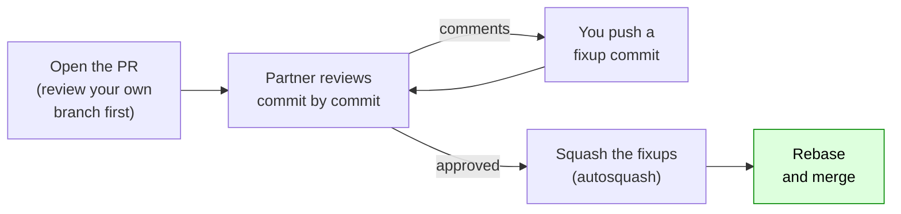

:::::::::::::::::::::::::::::::::::::: questions

- What makes a pull request easy to review?
- How do I give a review that helps?
- How do I change a pull request after feedback without confusing the reviewer?

::::::::::::::::::::::::::::::::::::::::::::::::

::::::::::::::::::::::::::::::::::::: objectives

- Check your own branch the way a reviewer will, before you open a pull request
- Write a pull request description that a reviewer will thank you for
- Review a pull request one commit at a time, and leave comments that help
- Respond to feedback with `--fixup` commits, then autosquash before merging
- Check that tidying your history didn't change the code (in VS Code, or with `git diff`)

::::::::::::::::::::::::::::::::::::::::::::::::

<!--
The sequence for the exercise was run by script: self-check, a --fixup commit pushed normally (no force),
autosquash later, `git diff @{u} HEAD` prints nothing (VS Code: Compare with Remote shows no changes), then --force-with-lease. range-diff is now an optional callout.
The pull request is INSIDE the learner's own fork (feature -> own main). Partners need collaborator access (set in episode 1).
REMIND: check the base repository on every pull request page. This is the FIRST pull request of the day (episode 10 no longer opens one), so the warning lives here.
-->

## A pull request is a story

A pull request asks for your branch to be merged. But it is more than a button. It is the place where your work is **read by another person**, where automatic checks run (episode 12), and where the decision to merge is made.

When you open one, you are handing someone a small story: *"Here is a change, here is why, here is how it was made."* Everything we have done so far, planning, atomic commits and a tidy history, exists to make that story easy to read.

A reviewer can read it in two ways:

- all at once, in the **Files changed** tab, which is one big diff
- **one commit at a time**, in the **Commits** tab, where each commit tells one part of the story

The second way is far easier, and it only works if your commits are atomic and well named. That is the payoff for the work we did on day 1.

Here is the life of a pull request, which is what we'll do in this episode:



*Today we'll go as far as the approval. Squashing and merging are the last step, and you can do them now or later.*

## Before you open it: review your own branch

The cheapest review is your own. Before you ask anyone else, look at your branch as they will. Go through these:

- [ ] **It reads like a story.** The Source Control Graph (or `git log --oneline main..`) shows commits that say what and why, with no `fixup!`, `wip` or `oops`.
- [ ] **Each commit stands alone.** `git rebase main --exec "pytest -q"` passes at every commit. (It should be quiet now that `main` has been fixed.)
- [ ] **It's up to date.** You've rebased onto the latest `main`, so there's nothing to resolve later.
- [ ] **It has only your change.** No debug prints, no stray files, no unrelated fixes. Read each commit's diff.
- [ ] **It's small.** If the pull request needs a long explanation, or touches many unrelated files, could it be two?

## Write a description a reviewer will thank you for

The title and description are the first things a reviewer reads. Tell them what they need to know:

- **What** changed, in a sentence or two
- **Why**: the problem it solves
- **How to check it**: the commands they can run, or what to look at
- Anything they should **pay particular attention to**, or that you aren't sure about

For our prominence feature, that might be:

```
Add a min_prominence option to find_peaks

Our example data has 71 "peaks" and only three real ones, because noise makes lots of
little bumps. A peak's prominence is how far it stands out above the surrounding
valleys, so a minimum prominence removes the bumps on the slope of a real peak.

Three commits: the prominence helper, the new option, and a test. Read them in order.

To check it, run `pytest`. The new test is `test_min_prominence_ignores_bumps_on_a_slope`.

Not sure about: how this should behave for flat-topped peaks.
```

::::::::::::::::::::::::::::::::::::: callout

## Pull request templates

Some repositories have a **pull request template**: a file called `.github/pull_request_template.md` that pre-fills the description box with headings (what changed, why, how to test, a checklist). If you see text already in the box when you open a
pull request, that's why. Fill it in rather than deleting it. A project without one can add its own, and it's a good way for a team to agree what a description should contain.

## Draft pull requests

If your work isn't ready but you want early feedback, or you want automatic checks to run, open it as a **draft** (the arrow on the green button). Nobody will
merge it by accident, and you can mark it **Ready for review** when it is.

::::::::::::::::::::::::::::::::::::::::::::::::

## Open the pull request

1. Push your branch: `git push`. (It's already on GitHub from day 1, so this should say everything is up to date.)
2. On GitHub, open **your fork**, and click **Compare & pull request** next to your branch. (Or **Pull requests**, then **New pull request**.)
3. **Check the base repository.** It must be **your own fork** (`YOUR-USERNAME/peakfinder`), with base branch `main`. Use the **base repository** dropdown to change it if needed. (See the warning below.)
4. Write the title and description. Click **Create pull request**.
5. In the right-hand sidebar, ask your partner for a review: **Reviewers**, then choose their username.

Look at the **Commits** tab. Each of your commits is there, one at a time. That's what your reviewer will use.

::::::::::::::::::::::::::::::::::::: callout

## Make sure the pull request is on *your* fork

Pull requests from a fork default to the project you forked **from**. If you create one against the original, you will be sending it to the course
repository. Check the "base repository" line at the top of the page before you press the button. It should show your own username. From here on, every
pull request in this workshop is **on your own fork**.

::::::::::::::::::::::::::::::::::::::::::::::::

## Giving a good review

Now **swap**. Your partner has opened a pull request in *their* fork. Open it (they'll send you the link, or it will be in your notifications).

### How to read it

1. Read the **description**. Do you know what to expect?
2. Go to the **Commits** tab. Read the commits **one at a time**, from the oldest. Does each one do what its message says?
3. Look at each commit's diff. Hover over a line in the diff and click the blue **+** to **comment on that line**.
4. Ask yourself: *Is this correct? Is it clear? Is anything missing, like a test?*

### What good comments look like

- **Be specific.** *"This loop is hard to follow"* is less useful than *"Could we name `i` as `index`? I had to scroll back to see what it was."*
- **Ask questions** rather than giving orders. *"What happens for a peak at the edge of the data?"* invites a conversation, and might teach you something.
- **Mark the small things.** Start optional, minor comments with **`nit:`** (short for *nitpick*) so the author knows they won't block the merge.
- **Suggest the change.** On a line comment, the **Add a suggestion** button writes your replacement code in the comment, and the author can apply it with one click.
- **Say what's good.** A review that is only complaints is hard to read. If something is neat, say so.
- **Review the code, not the person.** *"This doesn't handle..."* rather than *"You forgot..."*

When you've finished, click **Review changes** (top right of **Files changed**) and choose:

| Choice | Meaning |
|---|---|
| **Comment** | feedback only |
| **Approve** | looks good to merge |
| **Request changes** | something must change first |

::::::::::::::::::::::::::::::::::::: challenge

## Challenge: swap and review

Review your partner's pull request, one commit at a time, in the **Commits** tab. Leave **exactly three comments**:

1. one **`nit:`** (short for *nitpick*: a small thing the author could improve)
2. one **question**
3. one **suggestion**, using the *Add a suggestion* button

Then **submit the review** as **Comment** (we'll approve it in a moment).

**No partner, or your partner isn't ready?** Review the example pull request your instructor shares instead. <!-- FIXME: prepare an example pull request on the instructor's fork and put the link here. -->

Need an idea for something to comment on? Good first things to look at are the **docstring** of the helper function in the first commit, the **names** of variables
in it, and **what the test doesn't cover** (flat peaks, peaks at the edges, an empty list).

::::::::::::::::::::::::::::::::::::::::::::::::

## Responding to feedback

You've got a review, and you want to change something in an **earlier** commit, such as the docstring in your first commit. There are three common ways to do it, and each has a cost:

| Approach | What you do | Easy for the reviewer? | History afterwards | The catch |
|---|---|---|---|---|
| **"Address review" commits** | Add new commits on the end, e.g. `PR: rename variable`, and push normally | **Yes**: each new commit is exactly what changed | **Messy**, unless the pull request is squash-merged | Fine if your team squash-merges anyway, because the commits vanish |
| **Fixup commits, squashed before merging** | `git commit --fixup <hash>`, push normally. When approved, autosquash and `--force-with-lease` | **Yes**: same as above | **Clean** | Someone has to autosquash before the merge. GitHub's merge buttons won't do it for you, so you tell the reviewer |
| **Amend and force-push every round** | Fix the commit in place, `--force-with-lease` | **No**: new hashes everywhere, so they re-read everything | **Clean** | Easy to lose track of what changed. Comments become "outdated" |

**Our recommendation: fixup commits, squashed when it's approved.** It's the only one that is easy to review *and* leaves a clean history. The cost is one short bit of coordination: you say *"approved, so I'm squashing the fixups now. The
code won't change, and I'll check that."* If your team squash-merges every pull request, ignore all this: plain "address review" commits are fine, since the history is flattened anyway.

For a fixup, the steps are what you did yesterday, with one difference: you **push it normally**, with no force, because you only *added* a commit.

```bash
git log --oneline main..          # find the hash of the commit it belongs to
git commit --fixup <hash>
git push
```

```output
   ab0c4ef..9ae8b33  feature-prominence -> feature-prominence
```

Your reviewer opens the pull request and sees **one small commit**, `fixup! Add prominence function`, which contains **exactly** your change. There's nothing to re-read.

::::::::::::::::::::::::::::::::::::: challenge

## Challenge: respond and approve

1. **Address one of the comments** you received, as a **fixup** of the commit it belongs to. Stage it in VS Code, then `git commit --fixup <hash>` in the terminal, and **push it** (a normal push).
2. **Reply** to the comment: *"Done, in `<hash>`."*
3. As the reviewer, look at your partner's fixup commit in the **Commits** tab. It should be small and obvious. If it's right, **approve** their pull request: **Review changes**, then **Approve**.

:::::::::::::::::::::::: solution

```bash
git log --oneline main..
git add -u                                  # or stage in the Source Control view
git commit --fixup <hash-of-the-first-commit>
git push
```

Then reply on GitHub, and your partner approves from the **Review changes** button.

:::::::::::::::::::::::::::::::::

::::::::::::::::::::::::::::::::::::::::::::::::

## Finishing: squash and merge

When your pull request is approved, say so in a comment and tidy the history before merging. **Do this now if there's time, or later.**

```bash
git rebase -i --autosquash main
```

Your fixup folds into the commit it belongs to, and the commits get **new hashes**. Before you push, check that **nothing but the history changed**:

- **In VS Code:** in the **Source Control Graph**, right-click your newest commit and choose **Compare with Remote**. It compares your tidied branch with the version on GitHub, the one your reviewer approved. It should list **no changed files**.
- **On the command line:** `git diff @{u} HEAD` should print **nothing**. (`@{u}` means "the branch on GitHub that this one tracks".)

Then push the tidy version, safely (episode 9), and merge:

```bash
git push --force-with-lease
```

On GitHub, merge with **Rebase and merge**. Then update your local `main`:

```bash
git switch main
git pull
```

(For a per-commit comparison of the old and new series there is also `git range-diff @{u}...HEAD`, but the check above is usually all you need.)

::::::::::::::::::::::::::::::::::::: challenge

## Knowledge check

1. After autosquashing, `git diff @{u} HEAD` prints nothing, yet every commit has a new hash. How can both be true?
2. When are plain "address review" commits a perfectly good choice?

:::::::::::::::::::::::: solution

1. A diff compares **files**, and the files are identical. The *commits* are different, because squashing the fixup rewrote them (episode 2: a changed commit, or a changed parent, means a new hash). Same code, tidier history.
2. When your team squash-merges every pull request. The commits are flattened into one anyway, so how tidy they were makes no difference.

:::::::::::::::::::::::::::::::::

::::::::::::::::::::::::::::::::::::::::::::::::

::::::::::::::::::::::::::::::::::::: instructor

**Timing (about 30 minutes).** 12 minutes of talk, then the exercises in time-boxes: open the pull request (4), review (8), respond and approve (6). Use a visible timer.
Review takes longest, so don't let it overrun: **three comments only**. The **Finishing** section (squash and merge) is optional in the session: say it's there for when they have time, or to do later. (Learners who don't merge won't be affected: nothing in the later episodes needs this feature merged.)

**The base repository trap.** Check screens as people open their pull requests. Anything opened against the course repository should be closed and re-opened on the fork.

**Pairs.** Make sure each learner has been added as a collaborator (episode 1), and the invitation accepted: they need it to be asked for a review. If a partner is missing or behind, pair them with
a helper, or have them review the instructor's example pull request.

**Online.** Breakout rooms of two. Ask people to share the pull request link in the chat or room.

**Common problems:**

- **The pull request is against the course repository.** Close it and open a new one on the fork.
- **The reviewer can't find the pull request.** Send the link. Check notification emails.
- **They `git commit --fixup` the wrong commit.** The autosquash puts the change in the wrong place. `git rebase --abort`, or fix it with another interactive rebase.
- **They squash before the reviewer has looked** and then wonder where their comments went. GitHub keeps them, marked "outdated".
- **No partner.** Use the prepared example pull request. Have one ready on your own fork, with a few things to comment on.
- **`git diff @{u} HEAD` isn't empty.** Something else changed. Look at it with `git diff @{u} HEAD --stat`.
- **`@{u}` means nothing**, or errors: the branch has no upstream. `git push -u origin <branch>` sets it.
- **`@{u}` in some shells needs quoting** (`'@{u}'`). In Git Bash it works as is.
- **After merging, the branch still shows in the list.** There is a **Delete branch** button on the merged pull request.

**What to point out:** that every commit and every comment they wrote on day 1 and now is the thing the reviewer is reading. A reviewer who can follow the story approves faster.

::::::::::::::::::::::::::::::::::::::::::::::::

::::::::::::::::::::::::::::::::::::: keypoints

- A pull request is a story. Review your own first: it should read well, each commit should pass, it should be up to date and contain only your change
- Write a description that says what, why, and how to check it
- Review one commit at a time. Be specific, ask questions, mark small things with `nit:`, suggest changes, and say what's good
- Respond to feedback with `--fixup` commits that you push as they are, and autosquash when it's approved (say so first). If your team squash-merges, plain "address review" commits are fine
- `git diff @{u} HEAD` printing nothing (or **Compare with Remote** in VS Code showing no files) proves that tidying the history didn't change the code
- Use **Rebase and merge** to keep your curated commits and a straight history
- A pull request from a fork defaults to the original repository, so check the base repository is your own fork

::::::::::::::::::::::::::::::::::::::::::::::::
