:::::::::::::::::::::::::::::::::::::: questions

- How can I catch problems before a reviewer has to?
- What does "shift left" mean, and which checks belong where?
- What is continuous integration, and how do I set it up with GitHub Actions?

::::::::::::::::::::::::::::::::::::::::::::::::

::::::::::::::::::::::::::::::::::::: objectives

- Explain "shift left", and say where different kinds of check belong
- Describe pre-commit hooks and their trade-offs
- Read a GitHub Actions workflow, add one that runs the tests on every pull request, and read a failing run

::::::::::::::::::::::::::::::::::::::::::::::::

<!--
Checked here: the workflow file passes actionlint, and its exact commands (pip install -r requirements.txt, pytest, pip install ruff, ruff check .)
pass in a clean environment. I could NOT run GitHub Actions itself from here, so the first real run is a thing to test before the workshop.
The combined exercise (CI commit, then rename the 'max' mode in the code only, then a fixup, autosquash, all on ONE pull request) was run by script: one failing test, the fixup lands in the rename commit, both commits pass.
Actions are disabled on new forks until the owner enables them: check this BEFORE the exercise (setup page, step 6).
Action versions (checkout v7, setup-python v7) were the latest at the time of writing: re-check them.
Structure: shift left framing, then the stages in LEFT-TO-RIGHT order: editor, pre-commit, before you push, CI.
-->

## The bug nobody ran a test for

In episode 10 we found a bug in the colleague's commit. There was **already a test** that caught it. It failed the moment the change was made. It just wasn't run.

We can't rely on everyone remembering to run every check, every time, and a reviewer shouldn't have to find problems a machine could. So let's think about **where** each kind of check belongs.

## Shift left

Picture a change moving from left to right, from the moment you type it to the moment users have it. At each stage, a problem can be noticed, but **the later it's noticed, the longer you wait to find out and the more it costs to fix**.

```mermaid
flowchart LR
    accTitle: {Six stages a change passes through, and how long it takes to find a problem at each}
    accDescr: {From left to right: 1, in your editor, you find out as you type, instantly. 2, in a pre-commit hook, when you commit, in seconds. 3, running the tests yourself before you push, in seconds or minutes. 4, continuous integration after you push, in a few minutes. 5, code review, in hours or days. 6, released to users, in weeks. Problems are cheap to fix on the left and expensive on the right.}
    A["<b>1. Editor</b><br/>as you type<br/>(instant)"] --> B["<b>2. Pre-commit</b><br/>when you commit<br/>(seconds)"] --> C["<b>3. Your tests</b><br/>before you push<br/>(seconds to minutes)"] --> D["<b>4. CI</b><br/>after you push<br/>(minutes)"] --> E["<b>5. Review</b><br/>(hours to days)"] --> F["<b>6. Users</b><br/>after release<br/>(weeks)"]
    classDef cheap fill:#dfd,stroke:#080,color:#000
    classDef mid fill:#ffd,stroke:#a80,color:#000
    classDef dear fill:#fdd,stroke:#c00,color:#000
    class A,B,C cheap
    class D,E mid
    class F dear
```



*Green: cheap and fast to fix. Red: slow and expensive. Time runs left to right.*

**"Shift left"** means moving each check as far left as it sensibly can go. The rule of thumb is to **push a check left until it becomes too slow or too annoying to run there**:

| Stage | What belongs there | Why |
|---|---|---|
| **1. Editor** | formatting, lint warnings, typos, type errors | instant, and you never see them again |
| **2. Pre-commit** | the same fast checks, enforced | optional, and only if it stays fast |
| **3. Before you push** | the **tests** | too slow for every keystroke, but cheap to run now and then |
| **4. CI** | the tests **again**, on a clean machine, plus slower checks (other Python versions, building the docs) | nobody can skip it |
| **5. Review** | design, naming, "is this the right change?" | the things only a person can judge |

So **formatting** goes as far left as it can: set up your editor so it's fixed before you ever commit. The **tests** are slower and more costly, so you run them yourself before pushing, and CI runs them for everyone, regardless.
The point of the earlier stages is that review, and the users, only get to see changes that have already passed everything a machine can check.

## Stage 1: your editor

The earliest check is the one you don't have to think about. A **linter** finds likely mistakes without running your program, such as unused imports, undefined names and unreachable code. A **formatter** fixes layout. `ruff` is a fast tool that does both for Python, and
the **Ruff** extension for VS Code shows its findings as you type and can format when you save (turn on **Format on Save** in VS Code's settings).

On the command line, you can ask it the same question. In the original `peakfinder`, it finds the unused `import sys` that the colleague later removed:

```bash
ruff check .
```

```output
F401 [*] `sys` imported but unused
 --> peakfinder/cli.py:2:8
  |
1 | import argparse
2 | import sys
  |        ^^^
  |
help: Remove unused import: `sys`
```

This is the cheapest feedback there is, and it needs no workshop to set up. (How you configure these tools varies between projects, so look at what yours uses.)

## Stage 2: pre-commit hooks

Git can run a script **just before each commit**, called a *hook*. The **pre-commit** tool manages these for you. You list the checks in a `.pre-commit-config.yaml` file:

```yaml
repos:
  - repo: https://github.com/astral-sh/ruff-pre-commit
    rev: <a version>        # `pre-commit autoupdate` fills in the latest
    hooks:
      - id: ruff
```

Each person runs `pip install pre-commit` and `pre-commit install` once. From then on, `git commit` runs the checks on the files you're committing, and **refuses to commit** if one fails.

| Pros | Cons |
|---|---|
| Finds problems in seconds, before they're committed | Every contributor has to install it, and it is **not on by default** |
| Keeps everyone's formatting the same | Slow hooks interrupt every commit |
| Can fix things automatically (formatting) | Gets in the way of messy work-in-progress commits, which we may want to make and tidy up later |
| | Can be skipped: `git commit --no-verify` |

Opinions differ, and several of us find hooks more annoying than helpful. If you like them, use them and keep the hooks **fast** (formatting and linting, not the whole test suite). Never rely on them **alone**, because they can be skipped.

## Stage 3: run the tests before you push

Nothing clever here: run `pytest` before you push. For a quick check of **every commit** on your branch (not just the last), as we did in episode 7:

```bash
git rebase main --exec "pytest -q"
```

It stops at the first commit where the tests fail. That's how you confirm each commit is atomic, with the tests passing at every step.

## Stage 4: continuous integration

You can skip any of the stages above, and sometimes you will. **Continuous integration (CI)** is the one you can't skip, so it's the **backstop** for everything. Every time someone proposes a change, a computer automatically **builds the project and runs the checks**, on a clean machine, and reports back.

- A reviewer sees a **green tick or a red cross** on the pull request, before they've read a line.
- It runs in a **fresh environment**, so "it works on my machine" can't hide a missing dependency.
- It runs **every time**, whether or not anyone remembers.

**GitHub Actions** is GitHub's built-in way to do this, and it's free for public repositories. You describe what to run in a **workflow file**, a small YAML file in the `.github/workflows/` folder of your repository:

```yaml
name: Tests                          # what this workflow is called

on:                                  # WHEN to run it
  pull_request:                      #   on every pull request
  push:
    branches: [main]                 #   and on every push to main

jobs:
  test:                              # a job: a list of steps on one machine
    runs-on: ubuntu-latest           # GitHub gives us a fresh Linux machine
    steps:
      - uses: actions/checkout@v7    # use a ready-made action: get our code

      - uses: actions/setup-python@v7
        with:
          python-version: "3.12"
          cache: pip

      - name: Install the requirements
        run: pip install -r requirements.txt   # run a command

      - name: Run the tests
        run: pytest
```

Read it from the top: *when* it runs (`on`), *where* (`runs-on`), then the **steps**. A step either **uses** a ready-made action, or **runs** a command. The commands are
the ones you'd type yourself: the same `pip install` and `pytest` as in our setup page.

::::::::::::::::::::::::::::::::::::: callout

## YAML is fussy

YAML uses **indentation** to show structure. Use **spaces**, never tabs, and keep the indentation exactly as shown. A step that's one space out will fail with a confusing error.
VS Code shows the indentation guides, which helps.

::::::::::::::::::::::::::::::::::::::::::::::::

## Add CI, and watch it catch a mistake

We'll do this in **one pull request**: add the workflow, see it go green, then make a plausible mistake and watch CI catch it. The mistake is renaming something in the code but forgetting to update its test, and **pushing without running the tests**. (We're skipping stage 3 on
purpose. In real life, it happens by accident.)

::::::::::::::::::::::::::::::::::::: challenge

## Challenge: add CI, then break it and fix it

Your fork needs **Actions switched on**. Open the **Actions** tab of your fork. If it offers a button saying *"I understand my workflows, go ahead and enable them"*, click it. (You did this in the
setup. This is where we find out if it worked.)

::::::::::::::::::::::::::::::::::::: callout

## If Actions won't run for you

GitHub Actions is the one part of today that depends on GitHub doing something at the right moment, and sometimes it's slow, or switched off. If your checks don't appear or you're stuck waiting, **don't wait**. Watch the instructor's prepared run on screen, and carry on with
the git steps, which are the same either way: the commits, the fixup and the autosquash all work without Actions. You'll still see the point of CI.

::::::::::::::::::::::::::::::::::::::::::::::::

**Part 1: add the workflow.**

1. Update `main` and make a branch:

   ```bash
   git switch main
   git pull
   git switch -c add-ci
   ```

2. Create the file `.github/workflows/tests.yml` (in VS Code: create a folder `.github`, with a folder `workflows` inside it, and a file `tests.yml`) containing the workflow above.
3. Commit it with a clear message, and push:

   ```bash
   git add .github/workflows/tests.yml
   git commit -m "Run the tests on every pull request"
   git push
   ```

4. Open a pull request **in your own fork** (check the base repository!) from `add-ci` into `main`.
5. Scroll to the bottom of the pull request. In the **checks** section, you'll see your `Tests` job running (a yellow dot), then a green tick. Click **Details** to read the log, which shows each step.

**Part 2: break it, on the same pull request.**

6. In `peakfinder/normalise.py`, rename the mode `"max"` to `"maximum"` (the line `if mode == "max":`). **Only** the code. Commit and push, **without running `pytest`**:

   ```bash
   git commit -am "Rename the normalise mode 'max' to 'maximum'"
   git push
   ```

7. Go back to the pull request. The checks run again, and this time they **fail**: a red cross. Click **Details**, open the **Run the tests** step, and find the error. Is it the same as you would see locally?

**Part 3: fix it where it belongs, and merge.**

8. The test should have been part of the same commit. In `tests/test_normalise.py`, change `mode="max"` to `mode="maximum"`, then make it a **fixup** of the rename commit, and tidy up:

   ```bash
   git log --oneline -3
   git add -u
   git commit --fixup <hash of the rename commit>
   git rebase -i --autosquash main
   git push --force-with-lease
   ```

9. Watch the pull request: the checks run again, and go **green**.
10. Merge it with **Rebase and merge** (the rename is harmless, so we'll keep it), then update your local `main`: `git switch main`, then `git pull`.

If the job doesn't start at all, check the **Actions** tab is enabled, and that the file is in exactly `.github/workflows/`.

:::::::::::::::::::::::: solution

The workflow file is the one on this page. The finished steps:

```bash
git switch main
git pull
git switch -c add-ci
# create .github/workflows/tests.yml
git add .github/workflows/tests.yml
git commit -m "Run the tests on every pull request"
git push
# open the pull request on GitHub (base: your fork's main). Wait for the tick

# edit normalise.py: if mode == "max" -> "maximum"
git commit -am "Rename the normalise mode 'max' to 'maximum'"
git push                                  # CI runs, and fails

# edit tests/test_normalise.py: mode="max" -> mode="maximum"
git log --oneline -3
git add -u
git commit --fixup <hash of the rename commit>
git rebase -i --autosquash main
git push --force-with-lease               # CI runs again, and passes

# Rebase and merge on GitHub, then
git switch main
git pull
```

In step 7 the log shows:

```output
FAILED tests/test_normalise.py::test_normalise_max_mode - ValueError: unknown mode: max
1 failed, 7 passed
```

which is exactly what `pytest` would print on your own computer. After the autosquash, the pull request has **two** commits, each one passing: the workflow, and the rename with its test. The fixup workflow kept the mistake out of the history.

```output
28171b1 Rename the normalise mode 'max' to 'maximum'
7ba3c1f Run the tests on every pull request
```

(Your hashes will be different.)

:::::::::::::::::::::::::::::::::

::::::::::::::::::::::::::::::::::::::::::::::::

### Going further: more checks in CI

A good CI job is the list of things you'd want a careful reviewer to check by hand. The linter from stage 1 is easy to add. Append one more step (indented to match the others):

```yaml
      - name: Check the code for common mistakes
        run: |
          pip install ruff
          ruff check .
```

The same idea works for **formatting** (`ruff format --check .`), **type checks**, and **building the documentation**. Anything that's too slow to run in your editor, but worth running on every change, belongs here.

## How this connects to history

CI and everything else we have learned reinforce each other:

- **Each commit should pass, but CI usually only checks the tip.** The rename commit failed CI because its test was missing, and we fixed it *in the commit*, so every commit passes. `git rebase main --exec "pytest -q"` checks all of them.
- **Bisect uses the same test command.** CI keeps the commands you'd bisect with working.
- **Merging can be made conditional.** Repositories can require the checks to pass before the merge button works (*Settings*, then *Rules* or *Branches*). Then a failing change can't reach `main`, even by accident.
- **The reviewer sees the result.** A green tick means they can spend their time on the design, which is the one thing only they can do.

::::::::::::::::::::::::::::::::::::: challenge

## Knowledge check

Where would you put each of these checks, and why?

1. Fixing the formatting of your code
2. A test suite that takes ten minutes
3. Running the tests on three different versions of Python
4. Deciding whether a function has a good name

:::::::::::::::::::::::: solution

1. **Your editor** (format on save): it's instant, and you never see the problem again.
2. **CI**, and run a quick subset yourself before you push. A ten-minute check on every commit would be painful, but CI can run it in the background while you carry on.
3. **CI.** You'd rarely have three versions of Python to hand locally, and CI can run them in parallel on clean machines.
4. **Code review.** Only a person can judge it, and it's what review is for.

:::::::::::::::::::::::::::::::::

::::::::::::::::::::::::::::::::::::::::::::::::

::::::::::::::::::::::::::::::::::::: instructor

**Timing (about 26 minutes).** Talk for 10: the table of stages is the key idea, and the stage 2 and 3 sections can be quick. Then the single challenge, which has just **one pull request** for both exercises. **Start the CI pull request early and talk while it runs**: the first run takes up to a minute, and there's waiting time in the
exercise. If you're short on time, do part 1 together, then do part 2 and 3 (break and fix) as a **demonstration** on your screen. The "going further" step is talking only.

**Emphasise the principle**: *push each check left until it's too slow or annoying*. Ask the room: "what do you already run before pushing?"

**Test this before the workshop.** I could check the workflow with `actionlint` and its commands in a clean environment, but not run it on GitHub. Do the whole exercise on a real fork the day before. Also re-check the versions of
`actions/checkout` and `actions/setup-python`.

**Actions must be enabled on each fork** (setup page, step 6). Ask for a show of hands before you start. The **Actions** tab shows an enable button if not.

**Common problems:**

- **Nothing happens on the pull request.** Actions is disabled on the fork, or the file isn't in `.github/workflows/`, or the pull request is on the course repository instead of the fork.
- **The workflow fails with a YAML error.** Indentation, or a tab. Open the **Actions** tab and read the error.
- **"Rebase and merge" is greyed out.** The branch isn't up to date, or the repository setting is off. Check *Settings* then *General* then *Pull Requests*.
- **The test doesn't fail in the break-and-fix.** They renamed the string in the test as well. Start again.
- **After the autosquash the push is rejected:** use `--force-with-lease`.

**Prepare a fallback before the session.** Actions is the part most likely to slow the room down (it runs on GitHub, so you can't control the timing). Have these ready:

- **A prepared fork** with the `add-ci` pull request already open: a **green** run, and then the breaking commit with a **red** run, and a link to each. (Or screenshots of each stage if you can't rely on the network.)
- A decision made in advance about when to **stop waiting**. A sensible rule: if checks haven't appeared after two minutes, you screenshare the prepared run and move on.
- **Three levels of fallback**, from best to simplest: (1) learners run it themselves; (2) learners do the git steps, and you demonstrate the Actions results on your screen; (3) you explain and demonstrate everything, and learners just read the workflow file. Any of them still teaches the idea.

**Limits.** Public repositories get free Actions minutes. If the fork is private, the allowance is limited. Forks of public repositories are public.

**Bridge to episode 13:** *"We have a fix, merged on `main`. But users are still running version 0.2, which has the bug. How do we get the fix to them?"*

::::::::::::::::::::::::::::::::::::::::::::::::

::::::::::::::::::::::::::::::::::::: keypoints

- "Shift left": find problems as early, cheaply and quickly as you can. Push each check left until it becomes too slow or annoying to run there
- Formatting and linting belong in your editor. Tests you run yourself before pushing, and CI runs them again for everyone, plus anything slower
- Pre-commit hooks are an optional personal convenience, and can be skipped. CI is the shared gate that can't
- A GitHub Actions workflow is a YAML file in `.github/workflows/`: when to run, where, and a list of steps
- Fix a failing check in the commit it belongs to (`--fixup`, then autosquash), so that every commit passes

::::::::::::::::::::::::::::::::::::::::::::::::
