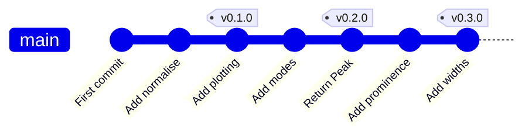
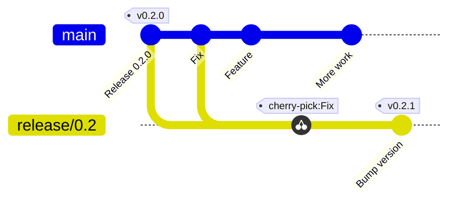

:::::::::::::::::::::::::::::::::::::: questions

- What does the life of a released project look like?
- How do I mark a release, and fix a bug in a version that's already out?
- How do I copy a single commit onto another branch?

::::::::::::::::::::::::::::::::::::::::::::::::

::::::::::::::::::::::::::::::::::::: objectives

- Describe a simple lifecycle for a released project, and what a version number tells you
- Explain how a tag differs from `HEAD` and from a branch
- Choose between "fix on `main` and release again" and "patch an old release"
- Cherry-pick a commit onto a release branch, and tag and push a release

::::::::::::::::::::::::::::::::::::::::::::::::

<!--
The challenge flow was run by script on a fresh copy of the example repo: find the fix on main, branch from the tag v0.2.0, show the test fail,
cherry-pick -x (clean), bump the version, tag, push the branch and the tag together (git push -u origin release/0.2 v0.2.1).
Version numbers are edited by hand in VS Code (sed -i differs on macOS).
Learners fast-forwarded the fix into main in episode 10 and deleted the branch, so they find the commit on main by its message.
Deliberately simple: this is a simplified lifecycle, not git flow. Bigger projects use fancier models: one sentence only.
-->

## The life of a released project

So far we've worked towards getting changes into `main`. But a project doesn't end there. Here is the simplified life of most software:

1. You **develop** on `main`, through small branches and pull requests.
2. At some point you **release**: you pick a version number and mark that commit.
3. Users run that version, and **find bugs**.
4. You **fix** them on `main`, and release again.

In git, that looks like a line of commits with a **tag** at each release:



That is the whole model. Bigger projects add more branches and ceremony (you may hear the name *git flow*), but most research software gets by with this. The one extra wrinkle is what to do when a bug is found in a version that's already out, which we'll come to.

## Version numbers

A release needs a name, and a **version number** is how people refer to it. Most projects use **semantic versioning**, three numbers, `MAJOR.MINOR.PATCH`:

| Change | Which number goes up | Example |
|---|---|---|
| Bug fixes only | **PATCH** | 0.2.0 to 0.2.**1** |
| New features that don't break existing use | **MINOR** | 0.2.1 to 0.**3**.0 |
| Changes that may break existing use | **MAJOR** | 0.3.0 to **1**.0.0 |

So the version tells a user what to expect before they upgrade: a patch should be safe to take, and a major release may need them to change something.

## Tags: names for releases

Git needs a way to say "this exact commit is version 0.2.1", and a **tag** is that. It helps to compare the three kinds of label git has:

| Label | Points at | Does it move? |
|---|---|---|
| **`HEAD`** | where you are right now | **Yes**: every time you switch or commit |
| **A branch** (`main`, `release/0.2`) | the latest commit of a line of work | **Yes**: every time you commit on it |
| **A tag** (`v0.2.1`) | one specific commit | **Never**: that's the point |

Because a tag never moves, "version 0.2.1" always means exactly the same code.

There are two kinds of tag:

| | Created with | What it is |
|---|---|---|
| **Lightweight** | `git tag v0.2.1` | just a label on a commit |
| **Annotated** | `git tag -a v0.2.1 -m "message"` | a label **plus** a small object that records who tagged it, when, and a message |

Use **annotated** tags for releases. `git show v0.2.1` shows the message. Two more things to know:

- **Tags aren't pushed by default.** You send one explicitly: `git push origin v0.2.1`.
- **A tag is on a commit, not a branch.** `git switch -c release/0.2 v0.2.0` makes a branch that starts at the tagged commit.

## A bug in a released version

Our version 0.2.0 was released with the `normalise` bug in it, and people are using it. We've fixed the bug on `main`, but `main` has moved on since then, and also contains new, unreleased features.

You have two options, from the lifecycle:

- **Fix on `main` and release a new version** (0.3.0). This is the simplest, and the right answer **when users can upgrade**. Do this if you can.
- **Make a patch release** (0.2.1) of the *old* version. This is for when users **can't** just upgrade: perhaps 0.3.0 changes something they depend on, or it isn't ready. We want to give them **just the fix**.

For the second option, we make a **release branch** that starts from the old version's tag, and bring the fix across. We don't want the whole of `main`, only that one commit. How do we copy a single commit?

## Cherry-pick

`git cherry-pick <commit>` takes **one commit** from anywhere in the repository and **replays its change** on top of your current branch, as a new commit. This is the "commit as a change" way of
thinking from episode 2: git works out what that commit changed, and applies the same change here.

```bash
git switch <the branch you want to put it on>
git cherry-pick <hash of the commit to copy>
```



It makes a **new commit** with a **new hash**, as the parent is different. So the original and the copy are two separate commits with the same change. The option `-x` records where it came from, in the message:

```
(cherry picked from commit 05c314d857072a26b300c8be5ce6a350126c3000)
```

That makes it easy to see later that two commits are the same fix. Use `-x` whenever you cherry-pick onto a *shared* branch, such as a release.

::::::::::::::::::::::::::::::::::::: callout

## This only works because of atomic commits

Our fix is **one small commit** that does one thing. It can be copied cleanly, and the result is a sensible release.

If the fix had been bundled into a larger commit along with a new feature, cherry-picking it would drag half the feature along, or fail with conflicts because the feature depends on code the release branch
doesn't have. That's the episode 3 payoff again: **atomic commits are what make cherry-pick safe**.

::::::::::::::::::::::::::::::::::::::::::::::::

::::::::::::::::::::::::::::::::::::: callout

## In VS Code

In the **Source Control Graph**, right-click a commit and choose **Cherry Pick** to apply it to the branch you have checked out. (If you can't see the commit, change which branches the graph is showing.) If there's a conflict, resolve it
in the merge editor as before, then finish with `git cherry-pick --continue` in the terminal. To give up, run **Git: Abort Cherry Pick** from the Command Palette, or `git cherry-pick --abort`.

::::::::::::::::::::::::::::::::::::::::::::::::

::::::::::::::::::::::::::::::::::::: challenge

## Challenge: release the fix as version 0.2.1

Work in your clone, with your virtual environment active.

**1. Make a release branch and bring the fix across.** First find the fix on `main`: it has the message *Fix 'range' mode of normalise...*. (You deleted your `fix/normalise` branch, so look it up by its message.) Then branch from the old tag, check the bug is there, and cherry-pick:

```bash
git switch main
git pull
git log --oneline --grep="Fix 'range' mode"

git switch -c release/0.2 v0.2.0
pytest tests/test_normalise.py           # fails: the bug is in 0.2.0
git cherry-pick -x <hash of the fix>
pytest                                   # passes
```

**2. Bump the version, tag it, and push.** Change the version to `0.2.1` in two places, `__version__` in `peakfinder/__init__.py` and `version` in `pyproject.toml` (edit them in VS Code). Then:

```bash
git commit -am "Bump version to 0.2.1"
git tag -a v0.2.1 -m "Version 0.2.1: fix the 'range' mode of normalise"
git push -u origin release/0.2 v0.2.1
```

**3. Check it:**

```bash
git log --oneline --graph --all --decorate -8
```

You should see `v0.2.1` on `release/0.2`, with the cherry-picked fix just below it, and the new features only on `main`.

**Optional: publish a GitHub release.** On your fork's page, click **Releases**, then **Create a new release**. Choose the tag `v0.2.1`, click **Generate release notes**, and then **Publish release**.

:::::::::::::::::::::::: solution

```bash
git switch main
git pull
git log --oneline --grep="Fix 'range' mode"      # note the hash

git switch -c release/0.2 v0.2.0
pytest tests/test_normalise.py                  # fails
git cherry-pick -x <hash>
pytest                                          # passes

# edit __version__ in peakfinder/__init__.py and version in pyproject.toml to 0.2.1
git commit -am "Bump version to 0.2.1"
git tag -a v0.2.1 -m "Version 0.2.1: fix the 'range' mode of normalise"
git push -u origin release/0.2 v0.2.1
```

The cherry-pick:

```output
[release/0.2 9bbd943] Fix 'range' mode of normalise for spectra that don't start at zero
 Author: Sam Scientist <sam.scientist@example.org>
 1 file changed, 1 insertion(+), 1 deletion(-)
```

and the picture afterwards (hashes will differ):

```output
* fe33fcc (HEAD -> release/0.2, tag: v0.2.1, origin/release/0.2) Bump version to 0.2.1
* 9bbd943 Fix 'range' mode of normalise for spectra that don't start at zero
| * 05c314d (origin/main, main) Fix 'range' mode of normalise for spectra that don't start at zero
...
* df97539 (tag: v0.2.0) Bump version to 0.2.0
```

The same fix is on both branches, as two different commits. `release/0.2` has the fix and **none** of the new features.

:::::::::::::::::::::::::::::::::

::::::::::::::::::::::::::::::::::::::::::::::::

::::::::::::::::::::::::::::::::::::: callout

## Releases and research software

A tagged release is what people **cite and reproduce**. If you link your GitHub repository to [Zenodo](https://zenodo.org), every GitHub release gets its own **DOI**, a permanent citable identifier for exactly that version.
A `CITATION.cff` file in the repository tells people how to cite you. Tags and releases turn "the code I used in the paper" into something others can find.

::::::::::::::::::::::::::::::::::::::::::::::::

::::::::::::::::::::::::::::::::::::: challenge

## Knowledge check

1. A bug is found in 0.2.0, and 0.3.0 has just been released. Users can upgrade without trouble. Do you need a release branch?
2. Which of `HEAD`, a branch and a tag will still point at the same commit tomorrow, whatever you do?
3. Why does the cherry-picked fix have a different hash from the original?
4. A teammate cherry-picks a commit that adds a feature, and it fails with a conflict. What is the likely reason?

:::::::::::::::::::::::: solution

1. **No.** Fix it on `main`, and release 0.3.1 (or whatever comes next). A release branch is only needed when users can't move to the new version.
2. The **tag**. `HEAD` and branches move when you switch or commit.
3. A commit's hash depends on its parent (and the other contents). The copy sits on a different parent, so it's a new commit, even though its *change* is the same. `-x` records where it came from.
4. The commit depends on earlier commits that the target branch doesn't have, such as a helper function the feature uses. A commit that is a self-contained change copies cleanly. That's why atomic commits matter.

:::::::::::::::::::::::::::::::::

::::::::::::::::::::::::::::::::::::::::::::::::

::::::::::::::::::::::::::::::::::::: instructor

**Timing (about 35 minutes).** 15 minutes for the lifecycle, versions, tags and cherry-pick, and 20 for the exercise. The GitHub release is optional, and a good thing to demo while people finish.

**Keep the lifecycle simple.** Don't be drawn into branching-model debates. If someone asks about git flow, say it's a heavier version of the same idea, for software with scheduled releases, and move on.

**Find the fix by its message.** Learners deleted their `fix/normalise` branch in episode 10, so they look up the commit on `main` with `git log --grep`. (The hash is the same one the branch had, but they may not have noted it.)

**Common problems:**

- **`git cherry-pick` says the commit is empty or already applied.** They are on `main` instead of `release/0.2`. Check `git branch --show-current`.
- **`git switch -c release/0.2 v0.2.0` says the tag doesn't exist.** Their fork has no tags (forked with "Copy the default branch only"). `git tag` shows what's there. They can fetch tags from the original repository, or pair up.
- **They forget `-x`.** Harmless here, but explain what it would have told them.
- **A conflict on the cherry-pick.** It shouldn't happen. If it does, they've probably edited `normalise.py` on the release branch. `git cherry-pick --abort` and start again.
- **They tag with a lightweight tag** (no `-a`). It works, but `git tag -n` shows no message. Delete it (`git tag -d v0.2.1`) and re-tag.
- **The tag doesn't appear on GitHub.** They pushed the branch but not the tag. `git push origin v0.2.1`.
- **No "Create a new release" button.** On a fork, check **Releases** is enabled under *Settings*.

**Bridge to episode 14:** *"That's the whole workflow. A few things to make it quicker."*

::::::::::::::::::::::::::::::::::::::::::::::::

::::::::::::::::::::::::::::::::::::: keypoints

- Most projects follow a loop: develop on `main`, release with a version number and a tag, fix bugs on `main`, and release again
- Semantic versioning (`MAJOR.MINOR.PATCH`) tells users what to expect from an upgrade
- A tag is a label that never moves, unlike `HEAD` and branches. Use annotated tags (`git tag -a`) for releases, and push them explicitly
- If users can upgrade, fix on `main` and release again. If they can't, patch the old release on a release branch
- `git cherry-pick -x <commit>` replays one commit's change as a new commit, and atomic commits are what make it safe

::::::::::::::::::::::::::::::::::::::::::::::::
